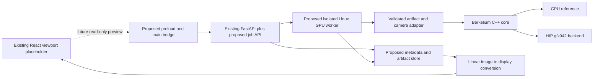
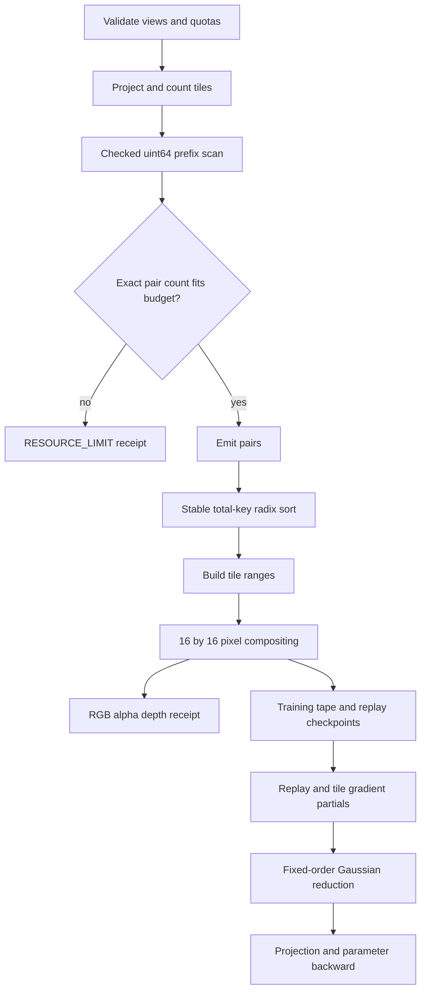

# Berkelium-Owned Differentiable Gaussian Renderer Specification

**Status:** proposed architecture, revision `berkelium-gaussian-v0.1` (2026-10-11). This document specifies future behavior; it does not implement a renderer. No HIP kernels, C++ library, training loop, native build, or renderer binding are present in the inspected target repository. All APIs, binary layouts, thresholds, tests, and gates below are **proposed** unless explicitly labelled **existing**.

## 1. Target evidence and ownership

| Target surface | Existing evidence | Consequence for this design |
| --- | --- | --- |
| Scene model | `packages/scene-core/index.js`: `SceneManager` uses a `Map`; `createBasicScene()` returns version `1.0`, metadata, and an empty `objects` array. | Add a future Gaussian artifact reference; do not put millions of parameter arrays in scene JSON. |
| Job system | `packages/job-orchestrator/index.js`: simulated CPU/GPU capabilities, timed progress, process-local jobs; `submitJob()` awaits the simulation. | The orchestrator is not a HIP scheduler or proof of GPU availability. Use an isolated native worker later. |
| Interchange | `packages/interchange-layer/index.js`: simulated imports/exports, random fidelity reports, placeholder coordinate conversion. | Its PLY/glTF/USD declarations are not functioning Gaussian loaders. Implement explicit adapters and round-trip tests later. |
| Desktop and backend | `apps/desktop/src/App.jsx` has a placeholder viewport; `services/backend/main.py` has health/chat/OCR/PDF OCR routes, not neural jobs. | Three.js display and FastAPI handlers must not own training or GPU allocations. |
| Product phase | `README.md` explicitly excludes neural training in Phase 1. | Native research is a separate, later opt-in worker capability; documenting it does not enable desktop mutation. |
| Local license | Root `LICENSE` is MIT, copyright 2026 enigmahacker. | Independently authored Berkelium code can follow the repository license; imported code retains its own obligations. |

The extracted directory has no `.git` metadata; its upstream commit is unknown. Local file paths above identify the inspected snapshot, not an invented target revision. See also [REPOSITORY_INTEGRATION_MAP.md](REPOSITORY_INTEGRATION_MAP.md) and [NEURAL_RENDERING_API.md](NEURAL_RENDERING_API.md).

**Decision:** Berkelium owns the mathematical contract, portable C++17 CPU reference, HIP implementation, scene format, tests, and worker adapter. The 3DGS paper is an algorithm reference, not a requirement to copy Graphdeco's CUDA implementation. That implementation has research/non-commercial terms [S2]. Apache-licensed gsplat is a comparison/reference candidate [S3], not evidence of a working AMD backend. Record provenance and notices for every incorporated dependency; HIP translation does not change a source license.

## 2. Scope and platform

### First complete milestone

- Anisotropic 3D Gaussians, fixed topology, degree-zero/view-independent linear RGB.
- Pinhole cameras, one camera per call; batches loop over cameras with independent scratch/tapes.
- Forward RGB, accumulated alpha, and optional expected camera-space depth.
- Analytic backward for centers, log-scales, raw quaternions, opacity logits, and color logits; optional background RGB gradient.
- Standalone CPU executable/library usable without ROCm, Python, Electron, or model weights.
- Linux HIP worker targeting **MI300X / CDNA3 / `gfx942`**, with 64-lane wavefronts and 192 GiB nominal HBM [S4]. Available memory must be queried, not inferred from that capacity.
- CMake targets proposed as `berkelium_gaussian_cpu`, `berkelium_gaussian_hip`, and `berkelium_gaussian_tests`; suggested future home `packages/gaussian-renderer/`. These paths/targets do not exist today.

### Deferred capabilities

SH degrees 1–3, distortion, orthographic cameras, camera/intrinsic gradients, per-pixel depth ordering, Mip-style opacity compensation, multi-GPU/distributed training, mixed precision, mesh extraction, densification/pruning, and text-conditioned guidance are separate gated extensions. An unsupported request returns `UNSUPPORTED_FEATURE`; never silently drop SH coefficients or camera gradients. This renderer is not a watertight mesh generator or exact CAD modeler.

## 3. Proposed integration boundaries



- `scene-core` keeps object identity, transforms, units, bounds, and `artifactId`; native buffers are service-owned.
- Future `neural_rendering_training` jobs call the worker; `rendering_conversion` can produce previews/import conversions. Existing simulated job completion cannot publish native artifacts.
- A Python/PyTorch extension is optional for loss/optimizer research. It wraps the same native API, uses the current HIP stream, and checks ROCm availability. PyTorch's `cuda` device spelling also applies on HIP [S6]; it is not proof of NVIDIA hardware.
- The native core has no HTTP, prompt generation, SQLite, path authorization, arbitrary command execution, or automatic model downloads.
- FastAPI receives bounded typed metadata and opaque references, never device pointers or arbitrary worker executable paths. Main/preload transports images or artifact handles, not HIP objects.
- MI300X is a headless compute target. Copy a bounded preview to host and display through the desktop renderer; do not assume Electron/WebGL can share its GPU context.
- Phase 1 remains read-only. Future job submission follows the policy and persistence boundaries in `NEURAL_RENDERING_API.md`.

## 4. Coordinates, units, and camera contract

### Canonical spaces

| Item | Normative proposed convention |
| --- | --- |
| World | Right-handed, +X right, +Y up, +Z completing the right-handed basis. Default front camera is on +Z looking toward the origin. |
| Units | Meters when scale is known. Synthetic/generated scenes may use explicitly labelled `normalized_object` units; never relabel an unknown scale as meters. |
| Camera | OpenCV-style right-handed axes: +X right, +Y down, +Z forward. |
| Pose | `T_cw` maps world **to camera**: `p_c = R_cw p_w + t_cw`. Camera center `C_w = -R_cw^T t_cw`. |
| Matrices | Row-major storage, column-vector mathematics; `T_cw` is 4×4, last row `[0,0,0,1]`. No implicit transpose. |
| Intrinsics | `fx, fy > 0`, `cx, cy` in pixel units, zero skew, no distortion in v0.1. |
| Image | Origin top-left; sample center `(x+0.5, y+0.5)`. Principal point `(W/2,H/2)` gives a centered symmetric camera. |
| Projection | `u = fx X/Z + cx`, `v = fy Y/Z + cy`, with `near < Z < far`. Depth is **Z**, not Euclidean range. |
| Color | Linear RGB float output. Input sRGB images are explicitly decoded; sRGB encoding/tone mapping happens only for display/export, outside backward. |

Camera validation requires finite values, dimensions in `1..8192`, positive focal lengths, `0 < near < far`, `||R R^T-I||_max <= 1e-5`, and `abs(det(R)-1) <= 1e-5`. Reflection/scaled poses are rejected. Default normalized-object fixtures use `near=0.01`, `far=100`; actual projects set these in their units.

**Adapters must make basis changes explicit:**

- Given an OpenGL camera-to-world pose `T_wc_gl`, let `F=diag(1,-1,-1,1)`. Then `T_wc_cv = T_wc_gl F` and `T_cw = inverse(T_wc_cv)` (same world basis).
- Given COLMAP world-to-camera extrinsics, retain the camera axis convention, then apply an explicit world-to-canonical basis/unit transform if needed. Check the imported principal-point/pixel-center convention with a reprojection fixture; do not universally add or subtract half a pixel.
- If source world coordinates change by `p_b = s B p_s + b`, where `B` is a proper rotation and `s>0`, transform means, all camera centers, and covariance consistently: `Sigma_b = s^2 B Sigma_s B^T`. Store the inverse transform for export. Non-uniform scaling requires transforming the full covariance and refactorizing it, not multiplying three unrelated local scales.
- USD/glTF, Blender, MVDream, and InstantMesh need named adapters. World-axis conversion (left multiplication) is different from camera-axis conversion (right multiplication). No heuristic axis inference from file extension.
- Resize by factors `sx,sy`: scale `fx,cx` by `sx`, `fy,cy` by `sy` under this edge-origin convention. Cropping subtracts crop origin from `cx,cy`; letterboxing adds the padding origin. Record the operation order.

## 5. Scene parameterization and SoA memory layout

### Authoritative parameter arrays

For `N` active entries and padded capacity `Nc = ceil(N/64)*64`, each plane is contiguous and starts on a 256-byte boundary. Array ownership is explicit; metadata contains `N`, `Nc`, schema version, device, generation, units, and normalization transform. Padding is initialized and never rendered/trained.

| Planes | Type / count per Gaussian | Interpretation |
| --- | --- | --- |
| `mean_x, mean_y, mean_z` | FP32 × 3 | World-space center. |
| `log_scale_x, log_scale_y, log_scale_z` | FP32 × 3 | `s = exp(clamp(log_scale, log(1e-5), log(1e2)))`, in scene units. Bounds are recorded config, fixed during a forward/backward pair. |
| `quat_w, quat_x, quat_y, quat_z` | FP32 × 4 | Hamilton `(w,x,y,z)`, active rotation from local Gaussian axes to world. Raw trainable quaternion normalized during projection. |
| `opacity_logit` | FP32 × 1 | Base opacity `o = sigmoid(logit)`. Not volumetric density or premultiplied alpha. |
| `color_logit_r, color_logit_g, color_logit_b` | FP32 × 3 | `c = sigmoid(color_logit)` in linear RGB, degree zero. |
| `gaussian_id` | uint64 × 1 | Unique immutable tie-break ID, independent of array order. Never differentiated or reused after deletion. |
| `flags` | uint32 × 1 | Enabled bit; all unknown bits rejected in v0.1. Disabled entries have zero gradients. |

There are **14 trainable floats = 56 bytes/Gaussian**, plus 12 bytes of identity/flags = 68 bytes before plane alignment/padding. Gradients mirror the 14 planes (56 bytes). Adam moments, if used by a separate optimizer, add 112 bytes. Native parameters + gradients + two moments therefore cost approximately **236 `Nc` bytes**, not including scratch, copies, or checkpoints.

Quaternion norm `<1e-8` is `INVALID_QUATERNION`, not an implicit identity. Use `qhat=q/||q||` and the standard Hamilton rotation:

```text
R(qhat) = [1-2(y²+z²), 2(xy-wz),   2(xz+wy)
           2(xy+wz),   1-2(x²+z²), 2(yz-wx)
           2(xz-wy),   2(yz+wx),   1-2(x²+y²)]
Sigma_w = R diag(sx², sy², sz²) R^T
```

Use the normalized quaternion in forward; backward includes normalization. `q` and `-q` render identically. Serialization may canonicalize sign (`w>=0`, lexicographic tie-break when `w=0`), but must not change sign during a recorded optimization step.

### Derived buffers and serialization

- Projected SoA: screen center (2), inverse-covariance/conic (3), camera Z (1), opacity (1), RGB (3): 10 FP32 planes. Also clipped integer AABB (4 int32), valid flags (uint32), tile count and prefix offset (uint64 each). Budget conservatively at **80 `Nc` bytes** with alignment.
- Pair record: `tile_id:uint32`, positive-depth FP32 bits `depth_key:uint32`, `gaussian_id:uint64`, `scene_index:uint32`; reserve a **32-byte record**. Two sorting buffers cost 64 `M` bytes for `M` Gaussian/tile overlaps. No 16-bit scene index or 32-bit byte-size arithmetic.
- Image views are planar `[channel][y][x]` FP32 with explicit `row_stride_bytes` and `plane_stride_bytes`; default dense CHW. RGB, alpha, depth numerator, and transmittance plus last-visited index are budgeted at 40 `P` bytes (`P=W*H`) including optional validity output. Upstream gradients and exported copies are additional allocations.
- A proposed `berkelium-gaussian-soa/1` artifact consists of a little-endian binary payload and JSON manifest: offsets, sizes, checksums, counts, types, basis, units, color model, parameterization, normalization, and provenance. It stores active entries, not pointers or native structs; validate overflow, truncation, overlap, and duplicate IDs before allocation.
- Generic point-cloud PLY lacks Gaussian semantics. An explicit Gaussian-PLY adapter must declare scale/log-scale, opacity/logit, quaternion ordering, color-space, and SH convention. Graphdeco-style DC conversion is `c=0.5+0.28209479177387814*f_dc`; converting it to our color logits uses `[1e-6,1-1e-6]` clipping and a loss report. Higher SH terms are rejected in v0.1 unless an explicitly lossy DC-only import is requested and recorded. An arbitrary PLY is never called a trained Gaussian scene.
- Future SH must have its own versioned basis/order and appearance model. Do not append unnamed planes or pretend RGB logits are SH coefficients.

## 6. Forward contract and mathematics

### Projection and finite support

For each enabled Gaussian:

1. Compute `p_c=(X,Y,Z)`, normalize quaternion, form covariance, and cull centers at `Z<=near` or `Z>=far`. This is center clipping, not exact clipping of a Gaussian against a plane; near-plane-crossing artifacts are a known v0.1 limitation.
2. With `R_cw` from the camera, calculate:

```text
J = [fx/Z, 0,    -fx*X/Z²
     0,    fy/Z, -fy*Y/Z²]
Sigma_c = R_cw Sigma_w R_cw^T
S = J Sigma_c J^T + lambda_px I_2
lambda_px = 0.3 pixel² (fixed v0.1 default)
Q = inverse(S) = [q00 q01; q01 q11]
```

The screen-space low-pass term is not Mip-Splatting opacity compensation. It changes footprint without preserving integrated mass; document it in artifacts and comparisons. Do not clamp `X/Z` or `Y/Z` behind the caller's back. A non-finite result or non-SPD `S` is `NUMERIC_FAILURE`, with index diagnostics, rather than silent covariance repair.

3. `r = ceil(3*sqrt(lambda_max(S)))`; use an integer square AABB conservatively containing `(u±r,v±r)`, clip to `[0,W)×[0,H)`, and emit all overlapped 16×16 tiles. Empty AABBs emit zero pairs. The AABB bounds candidate work only; pixel support uses the ellipse below. Giant footprints are bounded by the image and pair quota, not silently shrunk.
4. At sample `p=(x+0.5,y+0.5)`, `d=p-(u,v)`, `h=d^T Q d`. If `h>9`, contribution is zero. Otherwise `G=exp(-h/2)` and `a=min(0.99,o*G)`. There is **no additional alpha cutoff** in v0.1. This finite 3-sigma support is a documented approximation.

### Sorting and compositing

Sort each tile front-to-back by the total key **`(tile_id, depth_key, gaussian_id)`**. For strictly positive finite Z, unsigned IEEE FP32 bits are monotonic; exclude NaNs, negative/zero depths before key generation. Do not quantize depth. IDs break exact equal-depth ties, so memory permutation does not change compositing.

Use stable least-significant-field radix passes (ID, depth, then tile), or an equivalent tested total-key sort. Count/offset scans are uint64, checked before emission. CPU uses the identical comparison over derived FP32 keys; its high-precision oracle is only compared on cases with stable visibility/order.

For pixel-local accepted contributions in that order:

```text
T=1; C=(0,0,0); Ndepth=0
for i in sorted tile list:
    if T < 1e-4: stop BEFORE processing i
    if h_i > 9: continue
    w_i = T*a_i
    C += w_i*c_i
    Ndepth += w_i*Z_i
    T *= (1-a_i)
alpha = 1-T
rgb = C + T*background_rgb
depth = Ndepth/alpha if alpha >= 1e-6 else 0
depth_valid = (alpha >= 1e-6)
```

The contribution that crosses the transmittance threshold **is included**. Store the last **visited list position**, not just contributor count, so skipped ellipses and early exit replay consistently. Empty scenes yield exactly background RGB, alpha 0, depth 0, false depth validity, and zero gradients.

Sorting by center Z is deliberately a fast approximation; it is not ray-specific intersection sorting. Intersecting/large Gaussians can pop as order changes. Hold topology and ordering fixed in local gradient checks; assess popping separately in orbit tests.

## 7. Proposed native forward/backward API

The following is **interface pseudocode**, not declarations that exist in the target:

```cpp
Context create_context(Backend backend, int device_id, ContextOptions options);
Capabilities query_capabilities(Context const&);
ValidationReport validate_scene(SceneView const&, Camera const&, RenderConfig const&);
WorkspacePlan plan_workspace(SceneView const&, Camera const&, RenderConfig const&);
ForwardReceipt forward(Context&, SceneView const&, Camera const&, RenderConfig const&,
                       ImageViews outputs, Workspace&, Stream stream,
                       SaveForBackward save); // receipt owns an optional ForwardTape
BackwardReceipt backward(Context&, ForwardTape const&, OutputGradientViews upstream,
                         SceneGradientViews grads, BackgroundGradientView* bg,
                         Workspace&, Stream stream, GradientMode mode);
Status wait(CompletionEvent const&);
void release_tape(ForwardTape&);
```

| Contract | Required behavior |
| --- | --- |
| Context | Backend is `cpu` or `hip`; CPU has no HIP dependency. Device capability probing is real. No implicit CPU fallback when HIP is requested; return `DEVICE_UNAVAILABLE`. |
| Views | Typed const inputs, device tag, byte spans, counts/capacity, and strides; no output/input aliasing. Scene and images must reside on the selected device. Camera/config metadata are copied into the tape. |
| Workspace plan | First gives conservative pre-count requirements; exact count/sort requirements follow projection/count. If quotas are exceeded, return required bytes/pairs and `RESOURCE_LIMIT` before emission. No guessed allocation or partial valid image. |
| Save mode | `none` for inference, `training` to retain tape. Inference output has no implicit backward support. |
| Tape | Owns or pins projected arrays, sorted pairs/ranges, replay data, scene generation, config/camera snapshot, device/stream event. Caller pins source parameters until tape release; mutation invalidates backward. Tape may be reused for different upstream gradients only while intact. |
| Upstream | Optional CHW `dL/drgb`, `dL/dalpha`, `dL/ddepth`; absent planes mean zero. All must be finite. Depth gradient only acts where the forward validity flag is true. |
| Gradients | Match the raw 14 parameter planes. `overwrite` zeroes all entries first; `accumulate` adds to initialized caller-owned buffers. Frozen/disabled/culled entries contribute zero. No optimizer inside backward. |
| Camera gradients | v0.1 returns `UNSUPPORTED_FEATURE` if requested; no apparent zero gradient presented as support. |
| Asynchrony | Enqueue on the supplied stream; receipts contain a completion event and status. Host metadata validity does not imply kernel success. Inputs/workspace cannot be released until the event completes. CPU completes synchronously. |
| Errors | `INVALID_ARGUMENT`, `INVALID_SCENE`, `INVALID_QUATERNION`, `UNSUPPORTED_FEATURE`, `RESOURCE_LIMIT`, `OUT_OF_MEMORY`, `DEVICE_UNAVAILABLE`, `STALE_TAPE`, `NUMERIC_FAILURE`, `CANCELLED`, `DEVICE_ERROR`. Failed outputs/tapes are invalid. Native debug diagnostics stay in worker logs, not raw UI responses. |

A proposed PyTorch binding exposes `render(scene_tensors,camera,config)` through one custom autograd function. It validates dtype/contiguity/device, guards the current device and stream, records tensor versions, and maps saved tensors to the tape. It must not use the legacy default stream while PyTorch uses another one. Losses, image masks, Adam, learning schedules, topology changes, and checkpointing live above this binding.

## 8. Backward definition

Backward differentiates the **actual truncated, clamped forward function on its recorded branch**. It does not differentiate integer AABBs, tile membership, visibility, support membership, sorting, early-exit decisions, or the depth-validity predicate. This is piecewise differentiability, not a claim of global differentiability across occlusion changes.

### Compositing derivatives

Convert upstream depth to numerator/alpha gradients where valid:

```text
gN = gDepth/alpha
gA = upstream_alpha - gDepth*Ndepth/(alpha*alpha)
```

Use `gN=0` for invalid depth; RGB gradient is `gC`. For an accepted element, define suffix composites behind it with terminal `(B_rgb=background, B_N=0, B_A=0)` and recurrence:

```text
B_rgb_i = a_i*c_i + (1-a_i)*B_rgb_next
B_N_i   = a_i*Z_i + (1-a_i)*B_N_next
B_A_i   = a_i     + (1-a_i)*B_A_next
```

With `T_before_i` from forward replay:

```text
g_a_i = T_before_i * (dot(gC,c_i-B_rgb_next)
                     + gN*(Z_i-B_N_next) + gA*(1-B_A_next))
g_c_i = T_before_i*a_i*gC
g_Z_i_direct = T_before_i*a_i*gN
g_background = T_final*gC
```

For uncapped opacity (`oG<0.99`): `g_o=g_a G`, `g_G=g_a o`; at/above the cap use zero derivative through the cap. `g_logit=g_o o(1-o)`, and `g_color_logit=g_c c(1-c)`. At hard support/clipping boundaries use the recorded predicate and zero gradient through that decision; such points are excluded from smooth finite-difference tests.

For the exponent/conic path, `g_h=-0.5*G*g_G`, `g_d=2*g_h*Q*d`, `g_screen_mean=-g_d`; conic plane derivatives are `g_h*[dx²,2dxdy,dy²]`. Propagate `dQ=-Q(dS)Q`, then through `S`, `J`, `Sigma_c`, `R_cw`, and `Sigma_w`. Crucially, **J depends on X,Y,Z**; a backward that only differentiates projected means is incomplete. Add direct depth-Z gradient to the covariance/projection-Z path.

For covariance, differentiate `R diag(s²) R^T`; `d(s²)/dlog_scale=2s²` in unclamped regions, zero at/outside the configured clamps. Differentiate `R(qhat)` and apply `g_q=(I-qhat*qhat^T)g_qhat/||q||`. No derivative passes through IDs, flags, or scene count. CPU analytic derivatives are checked independently with a double-precision finite-difference oracle.

### Tape and deterministic accumulation

- Save sorted pairs, tile ranges, projected parameters, last-visited position, and **prefix-transmittance checkpoints every 32 list positions** for each pixel. Replay each chunk to reconstruct `T_before`; evaluate the same support/cap predicates and reverse suffix state. Never recover prefixes by dividing a near-zero terminal T through hundreds of factors.
- Checkpoints store FP32 T plus a count/index scheme. Worst-case count `H = sum_tiles(valid_pixels_in_tile * (ceil(tile_pair_count/32)+1))`; budget `4H` bytes plus indexing. Early-exit-aware compression may reduce this, but must preserve exact branch replay. Enforce a separate checkpoint quota; no allocation proportional to an unchecked giant list.
- Deterministic mode assigns one tile block, fixed pixel-to-lane mapping, and fixed reduction trees over 256 pixels per pair. It emits **10 projected-gradient floats per Gaussian/tile pair** (40 `M` bytes) with one writer per pair. Reorder indices by `(gaussian_id,tile_id)` and use Berkelium fixed-tree segmented reductions to sum pairs before one projection-backward evaluation per Gaussian. Extra permutation ping-pong buffers are budgeted at 8 `M` bytes.
- Integer scans and stable sorts may use rocPRIM [S5]. Do not assume a library floating-point reduction is reproducible; select an explicitly deterministic primitive or the fixed reduction implementation above.
- Fast mode may use FP32 atomic gradient accumulation after correctness is established. It must advertise `deterministic=false`, have measured error envelopes, and cannot generate deterministic golden results.
- Same build/device/config produces bitwise repeatable deterministic outputs/gradients. Cross-CPU/GPU or cross-toolchain comparisons use numeric tolerances; transcendental implementations need not be bit-identical.

## 9. HIP execution and resource model



- Start projection/count kernels at 256 threads/block; raster blocks are 16×16 threads (four MI300X waves), one thread/pixel. Use runtime wave size or backend-specific verified 64-lane operations, never CUDA's 32-lane mask assumptions.
- Stage 64 Gaussian projected records at a time in LDS (roughly 3 KiB for values and indices). Every thread, including out-of-image or terminated pixels, reaches barriers; inactive lanes simply contribute zero. Fixed gradient reduction scratch is planned separately and stays below a proposed 32 KiB/block budget. Profile registers/spills before changing batch size.
- Host reads one count/limit receipt after count/scan; this explicit synchronization is acceptable in v0.1. Then allocate/reuse scratch from a bounded context pool and enqueue sort/render. No per-frame unbounded allocator growth.
- One active research job/GPU first. Default hard caps: `N<=1,000,000`, `M<=8,000,000`, `W,H<=8192`, total context allocation <=16 GiB for renderer-only research, checkpoint allocation <=2 GiB. These caps are not a guarantee every combination fits; calculate the actual plan first.
- Approximate deterministic training bytes, including external Adam state, are `236Nc + 80Nc + 112M + 40P + 16Ttiles + 4H + S_library + alignment + upstream/copy bytes`. `112M` covers pair ping-pong (64), gradient partials (40), and reduction permutations (8). Query and include library scan/sort scratch; do not treat it as zero.
- Example: `N=1,000,000`, `M=8,000,000`, `P=1024²` costs about **1.25 GB decimal before replay checkpoints, library scratch, and copies**; it is not 192 GiB-safe by definition. Multiple tapes/batches multiply retained memory. Diffusion model weights are outside this budget and should run in a different stage/process.
- Return measured peak bytes, pair count, maximum pairs/tile, checkpoint bytes, visible count, clamp/cull counts, stage timings, backend, and deterministic flag. Huge splats and dense overlap must be visible in diagnostics.
- Cancellation is checked at stage/iteration boundaries; synchronize owned streams, invalidate pending receipts, and release resources before worker acknowledgment. A reset/invalid HIP context terminates that worker attempt rather than claiming successful CPU completion.
- CPU reference is suitable for small validation scenes. Memory limits and errors use the same contract; CPU fallback for inspection is an explicit caller choice, not an OOM recovery that silently runs a large training job.

## 10. Numerical policy

1. Authoritative storage and HIP computation are FP32 for parameters, covariance, conics, compositing, and gradients. No FP16/BF16 conics, opacity, or T in v0.1. CPU semantic reference has FP32 mode plus FP64 oracle mode using the same formulas.
2. Disable unsafe fast-math/reassociation for the deterministic baseline; record compiler, flags, ROCm and math-library versions. Specify contraction consistently within each build. No promise of bitwise CPU/HIP identity.
3. Stable sigmoid uses separate positive/negative branches; finite logits are allowed without arbitrarily clipping their inputs. Non-finite parameters/upstream gradients fail validation. Underflowing positive sigmoid/exp values may become zero; diagnose saturation and retain the defined derivative.
4. Scale clamps, support radius, low-pass variance, alpha cap, clipping planes, T threshold, and depth epsilon are serialized render config. Changing any invalidates a tape and comparison baseline.
5. FP64 oracle checks SPD/eigenvalues and analytic algebra on small scenes. HIP detects non-finite intermediate/output/gradient values. Do not mask a failure with `nan_to_num` or publish a partially rendered image.
6. Invalid expected depth is exactly zero with `depth_valid=false`. It has zero depth gradient; alpha/RGB still differentiate normally. Expected depth is not surface ground truth or a normal estimate.
7. The optimizer may report gradient norms and apply a separately declared clipping policy; clipping belongs to optimization, never hidden inside the renderer's backward.

## 11. Deterministic test matrix and acceptance gates

**All tests below are planned; none were run for this documentation task.** Fixtures use exact analytic constants or a specified PCG32 generator (state initialization `seed=12345`, stream `54`), not unspecified standard-library random distributions. Store fixture bytes and checksums when implemented. CPU oracle and HIP share inputs/config, not derivative implementation code.

| Fixture | Required evidence |
| --- | --- |
| Empty/disabled/culled scene | Exact background, zero alpha/depth/gradients; near/far equality follows the specified strict clipping rule. |
| One Gaussian at `p_c=(0,0,2)`, identity q, isotropic scale 0.1, opacity 0.5, RGB `(0.25,0.5,0.75)`, black background, 65×65 camera `fx=fy=64`, `cx=cy=32.5` | Central sample has `G=1`, alpha 0.5, RGB `(0.125,0.25,0.375)`, depth 2; symmetry and footprint match formulas. Raw parameters are corresponding logs/logits. |
| Two coincident projected centers at Z 2 and 3, same base alpha 0.5 | Central alpha 0.75; color weights 0.5 and 0.25; expected depth `(1+0.75)/0.75=7/3`. Swapping depth changes RGB as predicted. |
| Equal-depth overlapping splats; shuffled array order | IDs retain the exact same total-key order and deterministic result; duplicate IDs are rejected. |
| Rotated anisotropic Gaussian and q/-q pair | Covariance/ellipse match FP64 oracle; q/-q images identical, raw quaternion gradients transform by sign. Isotropic rotations have near-zero rotation gradient. |
| Edge tiles, off-screen center with visible support, 1×1 and 17×19 images | No out-of-bounds writes, no missed ellipse support, no divergent barrier deadlock. |
| Transform/import fixture | OpenGL-to-CV, units, crop/resize, and world-basis transformations reproduce the same image and depth scale. |
| Saturation/clamp/support/early-exit boundaries | Recorded branch and one-sided policy checked explicitly; cap derivative zero; threshold-crossing contributor retained. |
| Smooth gradient fixture (`N<=16`, 32×32, separated depths, anisotropic scales) | Each of the 14 raw parameter dimensions tested with central FP64 differences and joint directional derivatives, including RGB, alpha, and valid-depth upstreams. |
| Quota/error fixture | Invalid poses, zero q, NaNs, oversized counts, corrupted artifacts, missing HIP device, stale tapes, and intentional insufficient workspace return typed errors without valid output. |
| Lifetime/stream fixture | Non-default stream, repeated backward, overwrite/accumulate, release, cancellation, and two independent contexts behave as specified. |

Gradient oracle step is `h=1e-5*max(1,abs(parameter))`; rerun at `h/2` to establish stability and reject samples that cross a recorded branch. CPU analytic vs FP64 finite differences: `abs_err <= 1e-7 + 1e-4*abs(reference)`. HIP smooth-fixture gradients vs CPU analytic: `abs_err <= 2e-5 + 2e-3*abs(reference)` per parameter; directional derivative relative error <=`5e-3` when reference magnitude >=`1e-4`. Near-zero derivatives use absolute tolerance. A failed dimension cannot be hidden by mean-error aggregation.

Forward FP32/HIP vs FP64 on stable fixtures: RGB/alpha maximum absolute error <=`2e-4`; valid-depth error <=`1e-4 + 2e-4*abs(reference)`. Integer pair keys/ranges/visited positions must match on fixtures away from FP32 projection boundaries. Same-device deterministic hashes must match across 10 repeats. Boundary fixtures compare the defined branch, not a misleading smooth derivative.

| Gate | Go criteria | Stop/action |
| --- | --- | --- |
| G0 — contract/ownership | Independent source/provenance recorded; artifact/camera schemas and license obligations agreed. | No renderer code import from non-commercial implementations into the MIT target. |
| G1 — CPU semantics | All analytic forward fixtures, error/lifetime cases, and 14-plane FP64 gradient checks pass. | Fix the math/contract before HIP optimization. |
| G2 — HIP correctness | Forward/backward tolerances, total-key ordering, bounds/barrier checks, and 10-repeat determinism pass on one MI300X. | Investigate reduced CPU/HIP fixture; do not loosen thresholds solely to pass. |
| G3 — bounded MI300X run | Complete experiment E0 in `TEXT_TO_3D_RESEARCH_PLAN.md`: finite optimization, held-out checks, timing and memory receipts within quota. | No claims of text-to-3D or real-time capability from this gate. |
| G4 — practical renderer baseline | 100k Gaussians, <=2m pairs, 512²: median forward <=100 ms and forward+backward <=500 ms after warmup, peak <=4 GiB; report p95 and measured overlap. These are proposed engineering budgets, not observed speed. | If correctness passes but budgets fail, profile projection/sort/raster/replay separately; optimize the measured bottleneck. |
| G5 — product integration | Isolated worker, valid persisted artifacts, CPU inspection path, restart/cancel/error receipts, secure bridge, and Phase 1 policy verified. | Keep native research separate from desktop job writes until the later phase is approved. |

Densification and SH come only after these gates. Fixed-topology reconstruction quality must be reported honestly; passing kernel tests does not establish parity with full 3DGS training.

## 12. Source register and assumptions

Source review date: **2026-10-11**. A versioned documentation URL is a documentation reference, not the environment installed on a future machine. Branch URLs are mutable when no commit was resolved.

- **[S1] Algorithm:** Kerbl et al., *3D Gaussian Splatting for Real-Time Radiance Field Rendering*, https://repo-sam.inria.fr/fungraph/3d-gaussian-splatting/ and https://arxiv.org/abs/2308.04079. Paper version not pinned here; algorithm inspiration, not source reuse.
- **[S2] Original implementation/license:** https://github.com/graphdeco-inria/gaussian-splatting and https://github.com/graphdeco-inria/gaussian-splatting/blob/main/LICENSE.md. `main` reviewed; exact commit unresolved. License restricts commercial use without explicit consent; the associated rasterizer's own license must also be checked before any use.
- **[S3] Permissive comparison:** gsplat revision `512d366b67073d77ca099ede742683c165dfc23b`, https://github.com/nerfstudio-project/gsplat/tree/512d366b67073d77ca099ede742683c165dfc23b and https://github.com/nerfstudio-project/gsplat/blob/512d366b67073d77ca099ede742683c165dfc23b/LICENSE (Apache-2.0). Resolve native dependencies separately; do not assume a CUDA wheel supports HIP.
- **[S4] Hardware target:** ROCm **6.3.3 documentation**, https://rocm.docs.amd.com/en/docs-6.3.3/reference/gpu-arch-specs.html. MI300X: `gfx942`, wavefront 64, LDS 64 KiB, nominal memory 192 GiB. Future runtime/toolchain version remains to be measured and pinned.
- **[S5] Integer scan/scratch:** rocPRIM **3.3.0 / ROCm 6.3.3 documentation**, https://rocm.docs.amd.com/projects/rocPRIM/en/docs-6.3.3/device_ops/scan.html. Float scans are not automatically deterministic; integer counts and explicit overflow checks are this design's use case.
- **[S6] PyTorch HIP semantics:** https://docs.pytorch.org/docs/stable/notes/hip.html (mutable stable URL; installed PyTorch version unknown).
- **[S7] Camera adapter background:** MultiNeRF revision `5b4d4f64608ec8077222c52fdf814d40acc10bc1`, https://github.com/google-research/multinerf/blob/5b4d4f64608ec8077222c52fdf814d40acc10bc1/README.md, especially its OpenGL camera-to-world versus COLMAP/OpenCV conventions.

Assumptions: future access to one Linux MI300X worker; no GPU availability/toolchain inspection was performed; object-centric fixed-topology scenes precede large unbounded scenes; camera optimization is unnecessary for the first milestone; synthetic/owned data are available without model weights; existing Phase 1 read-only restrictions remain in force. No build, kernel test, training, benchmark, or weight download occurred in authoring this specification.
