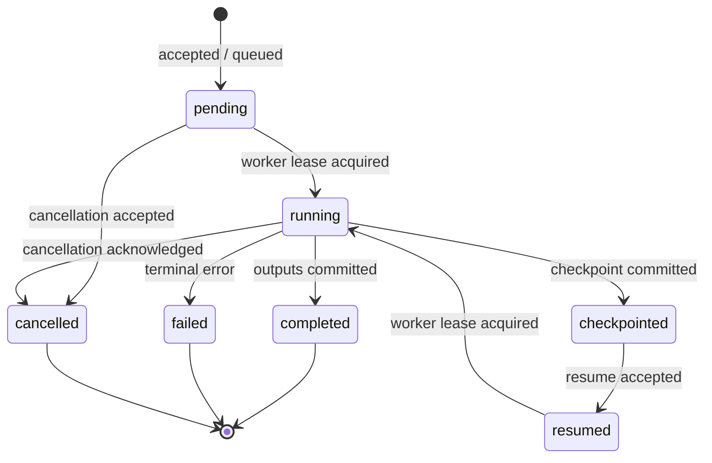
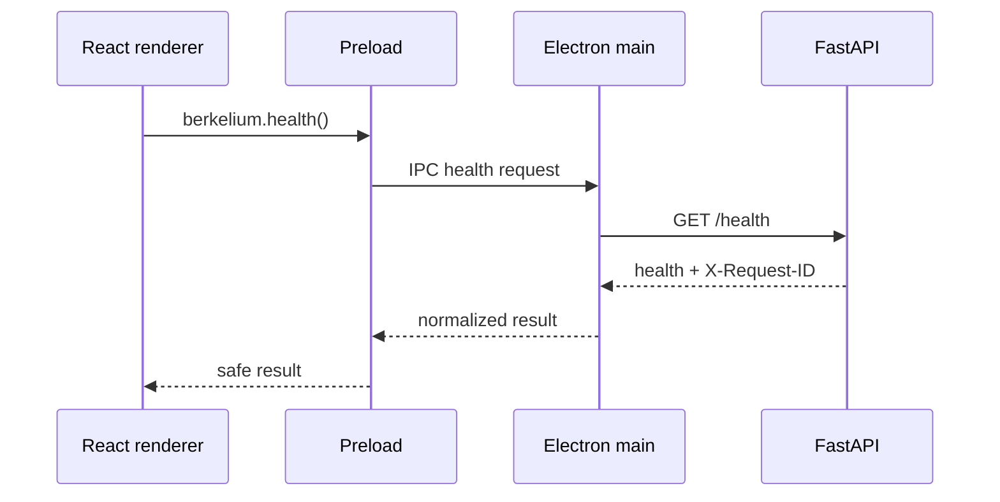

# Berkelium Neural Rendering API

## Scope and implementation status

This document defines a proposed, versioned API for project-scoped neural-rendering jobs and artifacts while documenting the FastAPI routes that actually exist today.

| Surface | Status in the extracted repository |
| --- | --- |
| `GET /health` | **Implemented** in `services/backend/main.py`. |
| `POST /chat` | **Implemented**; calls the configured Fireworks-compatible upstream. |
| `POST /ocr` and `POST /pdf-ocr` | **Implemented**; local OCR/text extraction helpers. |
| `/api/v1/projects`, `/api/v1/jobs`, `/api/v1/artifacts` | **Proposed only**. No such routes are present in `main.py`. |
| Persistent projects, jobs, and artifacts | **Proposed only**. Current JavaScript managers use in-memory `Map` objects. |
| Background neural-rendering worker | **Proposed only**. The current job orchestrator simulates work in process and is not connected to FastAPI. |

The API is designed for a local Electron client first. It must remain read-only for Phase 1: proposed write endpoints are documented so the boundary is explicit, but must return a policy response until the later mutation phase is approved.

## Transport, versioning, and common rules

- Proposed base URL: `http://127.0.0.1:8000/api/v1`.
- Existing unversioned compatibility routes remain at `/health`, `/chat`, `/ocr`, and `/pdf-ocr` until clients migrate.
- JSON uses UTF-8 and ISO-8601 UTC timestamps (`2026-01-01T12:00:00Z`).
- IDs are opaque strings, not filesystem paths or user-controlled timestamps.
- Every response should include `X-Request-ID`; the current backend already creates or propagates that header.
- Proposed authenticated routes require a local session credential in `X-API-Key` (or an equivalent main-process-held token). The existing backend makes this optional when `backend_api_key` is empty; that configuration is not sufficient for production.
- `Content-Length` and streamed body limits apply before persistence. The current backend caps request/upload bodies at 10 MiB and chat messages at 4,000 characters.

## Existing FastAPI routes

These are the routes currently implemented by `services/backend/main.py`; they are not job/artifact routes.

### `GET /health`

Optional query: `deep=1` also checks the configured Fireworks endpoint.

Example response shape currently returned:

```json
{
  "status": "ok",
  "components": {
    "tesseract": { "status": "ok", "version": "5.x" },
    "config": {
      "status": "ok",
      "fireworks_key_set": true,
      "model_id_set": true,
      "backend_key_set": true
    },
    "fireworks": { "status": "ok" }
  }
}
```

The `fireworks` component is omitted unless `deep=1`. Overall status is `ok` only when every reported component is `ok`; otherwise it is `degraded`.

### `POST /chat`

Implemented request model:

```json
{ "message": "Explain the scene pipeline" }
```

`message` is trimmed, must be non-empty, and is limited to 4,000 characters. The current response is:

```json
{ "response": "...assistant text..." }
```

The route is rate-limited to 30 requests/minute and optionally checks `X-API-Key`. The current desktop sends this request directly from `ChatPanel.jsx` with an empty key; a future preload/main bridge should own that transport and credential.

### `POST /ocr` and `POST /pdf-ocr`

Both accept a multipart `file`, enforce the 10 MiB body cap and a 30 requests/minute limit, then return:

```json
{ "text": "...extracted text..." }
```

`/ocr` requires an image content type; `/pdf-ocr` requires `application/pdf`. These routes do not create artifacts or jobs.

## Proposed resource model

The following schemas are proposed contracts. They should be implemented once in a shared contract package and used to generate FastAPI validation/OpenAPI and Electron IPC validation. The current `packages/contracts/index.js` descriptors are a starting point, but their runtime validator currently checks required fields only and does not enforce types or unknown-field policy.

### Common identifiers and envelope

```json
{
  "id": "opaque-id",
  "projectId": "project-opaque-id",
  "createdAt": "2026-01-01T12:00:00Z",
  "updatedAt": "2026-01-01T12:00:00Z"
}
```

Successful list response:

```json
{
  "items": [],
  "nextCursor": null
}
```

Error response (proposed normalized form):

```json
{
  "error": {
    "code": "JOB_NOT_FOUND",
    "message": "Job was not found.",
    "requestId": "a1b2c3d4e5f6",
    "details": {}
  }
}
```

`details` must contain safe field-level information only; it must not contain stack traces, API keys, absolute paths, or raw upstream payloads.

### Contract strategy

The proposed contract source of truth is `packages/contracts/index.js`, expanded from its current required-field descriptors into versioned strict schemas. The same operation should have one contract identity across the renderer bridge, FastAPI request model, and persistence boundary:

| Contract rule | Proposed behavior |
| --- | --- |
| Identity | Use an operation name and version, for example `job.submit.v1` or `scene.read.v1`. |
| Types | Enforce string/number/boolean/object/array types at runtime; a declared `type` is not documentation only. |
| Requiredness | Reject missing and `null` required fields before filesystem or worker work. |
| Unknown fields | Reject unknown fields by default; explicitly permit extension objects such as `options.parameters`. |
| Limits | Enforce string lengths, array counts, numeric ranges, enum values, and nested object depth. |
| Compatibility | Add a new version for breaking changes; accept old versions only through an explicit compatibility adapter. |
| Error shape | Convert renderer, IPC, and FastAPI validation failures to the normalized error envelope above. |

The preload-facing methods should be narrow typed operations rather than a generic request tunnel:

```text
health() -> HealthResponse
chat(request: ChatRequest) -> ChatResponse
listProjects(cursor?) -> ProjectListResponse
readScene(projectId, sceneId) -> SceneResponse
listJobs(filters?) -> JobListResponse
readJob(jobId) -> JobResponse
listJobArtifacts(jobId) -> ArtifactListResponse
readArtifact(artifactId) -> ArtifactStreamOrHandle
```

These signatures are proposed documentation contracts; no preload implementation currently exists.

### Project and scene

```json
{
  "Project": {
    "id": "project-123",
    "name": "Demo reconstruction",
    "version": "1.0.0",
    "createdAt": "2026-01-01T12:00:00Z",
    "updatedAt": "2026-01-01T12:00:00Z"
  },
  "Scene": {
    "id": "scene-123",
    "projectId": "project-123",
    "name": "Berkelium Scene",
    "format": "berkelium-scene-json",
    "version": "1.0",
    "updatedAt": "2026-01-01T12:00:00Z"
  }
}
```

The current `scene-core` basic document has `version: "1.0"`, `metadata`, and an `objects` array. Phase 1 should return scene metadata or a read-only document; scene writes are out of scope.

### Job request and job resource

Canonical job types mirror `packages/job-orchestrator/index.js`:

```text
scene_processing | photogrammetry | neural_rendering_training |
rendering_conversion | scientific_processing | build_and_test
```

`scientific_processing` is the canonical spelling because it is the accepted value in `supportedTypes`; the current duration switch contains a `science_processing` typo and should not define the API spelling.

Proposed request:

```json
{
  "projectId": "project-123",
  "type": "neural_rendering_training",
  "inputRefs": [
    { "artifactId": "artifact-input-1", "role": "training-data" }
  ],
  "options": {
    "priority": "normal",
    "checkpoint": true,
    "parameters": { "iterations": 10000 }
  },
  "idempotencyKey": "client-generated-unique-key"
}
```

Proposed job response:

```json
{
  "id": "job-123",
  "projectId": "project-123",
  "type": "neural_rendering_training",
  "status": "pending",
  "progress": 0,
  "priority": "normal",
  "inputRefs": [
    { "artifactId": "artifact-input-1", "role": "training-data" }
  ],
  "outputArtifactIds": [],
  "attempts": 0,
  "submittedAt": "2026-01-01T12:00:00Z",
  "startedAt": null,
  "completedAt": null,
  "error": null
}
```

The `options.parameters` object must be validated per job type, bounded in size, and allowlisted. It must never be interpreted as a shell command or executable path.

### Artifact resource

```json
{
  "id": "artifact-output-1",
  "projectId": "project-123",
  "jobId": "job-123",
  "kind": "neural-rendering-model",
  "mediaType": "application/octet-stream",
  "byteSize": 524288,
  "sha256": "hex-encoded-sha256",
  "createdAt": "2026-01-01T12:10:00Z"
}
```

Artifact metadata contains no client-chosen absolute path. The service maps the opaque ID to a controlled project-scoped store, verifies the checksum, and streams the bytes only after project authorization.

## Proposed endpoints

### Read-only project and capability endpoints

| Method | Path | Purpose | Phase 1 |
| --- | --- | --- | --- |
| `GET` | `/api/v1/projects` | List projects visible to the local session. | Enabled once persistence adapter exists. |
| `GET` | `/api/v1/projects/{projectId}` | Read project metadata. | Read-only. |
| `GET` | `/api/v1/projects/{projectId}/scenes` | List scenes for a project. | Read-only. |
| `GET` | `/api/v1/projects/{projectId}/scenes/{sceneId}` | Read a scene document/metadata. | Read-only. |
| `GET` | `/api/v1/capabilities` | Report available job types, provider/CPU/GPU capabilities, and Phase 1 policy flags. | Read-only. |
| `GET` | `/api/v1/projects/{projectId}/files/{relativePath}` | Read a project file through a canonicalized, authorized relative path. | Optional, read-only; prefer artifact IDs for generated data. |

Example:

```http
GET /api/v1/projects/project-123/scenes/scene-123
X-API-Key: <local-session-token>
X-Request-ID: inspect-001
```

```json
{
  "id": "scene-123",
  "projectId": "project-123",
  "name": "Berkelium Scene",
  "format": "berkelium-scene-json",
  "version": "1.0",
  "document": {
    "scene": { "name": "Berkelium Scene", "objects": [] }
  }
}
```

### Job and artifact endpoints

| Method | Path | Purpose | Phase 1 policy |
| --- | --- | --- | --- |
| `POST` | `/api/v1/jobs` | Validate and submit an allowlisted job. | **Disabled**; return `403 FEATURE_DISABLED` or `501 NOT_IMPLEMENTED`. |
| `GET` | `/api/v1/jobs` | List jobs, filterable by `projectId`, `status`, and `type`. | Read-only. |
| `GET` | `/api/v1/jobs/{jobId}` | Read current status and timestamps. | Read-only. |
| `GET` | `/api/v1/jobs/{jobId}/logs` | Read bounded, paginated job logs. | Read-only. |
| `POST` | `/api/v1/jobs/{jobId}/cancel` | Request cancellation. | **Disabled** in Phase 1. |
| `GET` | `/api/v1/jobs/{jobId}/artifacts` | List output artifacts for a job. | Read-only. |
| `GET` | `/api/v1/artifacts/{artifactId}` | Stream an authorized artifact. | Read-only. |
| `GET` | `/api/v1/artifacts/{artifactId}/metadata` | Read artifact metadata and checksum. | Read-only. |

Proposed later submission example:

```http
POST /api/v1/jobs
Content-Type: application/json
X-API-Key: <local-session-token>
Idempotency-Key: client-generated-unique-key
```

```json
{
  "projectId": "project-123",
  "type": "photogrammetry",
  "inputRefs": [{ "artifactId": "capture-set-1", "role": "input" }],
  "options": { "priority": "high", "parameters": { "quality": "draft" } }
}
```

Expected later response: `202 Accepted` with the `Job` resource in `pending`. A request handler must not block until training/rendering completes. The current `job-orchestrator.submitJob()` waits for its simulated `processJob()` and is therefore not an implementation of this endpoint.

## Job state machine

The existing orchestrator names these statuses: `pending`, `running`, `completed`, `failed`, `cancelled`, `checkpointed`, and `resumed`. The following is the proposed externally visible transition model, retaining those names for compatibility:



Rules:

- `progress` is an integer from 0 to 100 and is advisory, not proof of output validity.
- `completed` is written only after output files are atomically placed, checksummed, and recorded in the artifact table.
- `failed` includes a stable error code and safe message; retry policy belongs to the service/worker, not the renderer.
- `cancelled` is terminal for the job attempt. A later retry creates a new attempt or job according to idempotency policy.
- `checkpointed` and `resumed` are only legal for checkpoint-capable types. The current orchestrator advertises `neural_rendering_training` and `photogrammetry` as checkpointable.
- Clients should poll `GET /jobs/{id}` initially. Server-sent events or WebSockets may be added later without changing the resource schema.

## Errors and status mapping

| HTTP status | Proposed code | Meaning |
| --- | --- | --- |
| `400` | `INVALID_REQUEST` | Invalid combination, malformed JSON, or invalid job parameters. |
| `401` | `UNAUTHENTICATED` | Missing or rejected local session key. The current backend returns `invalid or missing api key` when configured to enforce a key. |
| `403` | `FEATURE_DISABLED` / `PROJECT_FORBIDDEN` | Phase 1 mutation is disabled or the project is not authorized. |
| `404` | `PROJECT_NOT_FOUND`, `JOB_NOT_FOUND`, or `ARTIFACT_NOT_FOUND` | Opaque resource does not exist or is intentionally hidden. |
| `409` | `IDEMPOTENCY_CONFLICT` / `INVALID_STATE_TRANSITION` | Reused idempotency key with a different body or illegal state change. |
| `413` | `PAYLOAD_TOO_LARGE` | Body or artifact exceeds configured limit. Current backend uses 413 for oversized bodies. |
| `415` | `UNSUPPORTED_MEDIA_TYPE` | Upload media type is not accepted; current OCR routes use 415. |
| `422` | `VALIDATION_ERROR` | FastAPI/Pydantic-style field validation failure. |
| `429` | `RATE_LIMITED` | Per-client or per-project quota exceeded; current routes are limited to 30/minute. |
| `500` | `INTERNAL_ERROR` | Unexpected service failure; log by request ID, do not expose internals. |
| `502` | `UPSTREAM_UNAVAILABLE` | Provider failure; current `/chat` maps rejected/unavailable Fireworks calls to 502. |
| `503` | `WORKER_UNAVAILABLE` | No eligible CPU/GPU worker or service is draining. |

Example:

```json
{
  "error": {
    "code": "INVALID_STATE_TRANSITION",
    "message": "A completed job cannot be cancelled.",
    "requestId": "inspect-001",
    "details": { "jobId": "job-123", "status": "completed" }
  }
}
```

## Security rules

1. **Trust boundary:** the renderer is untrusted UI code. Use a preload with `contextIsolation: true`, `nodeIntegration: false`, and `sandbox: true`; expose named methods, never raw IPC or Node primitives.
2. **Local service binding:** bind to loopback only for desktop mode. Do not expose the API on `0.0.0.0` by default. Restrict CORS to the exact packaged/dev origin; the current backend reads `allowed_origins` but currently permits `allow_headers=["*"]`.
3. **Authentication:** require a per-session/local credential for all non-health routes in the production desktop flow. Keep provider keys and backend credentials out of React and preload objects. An empty `backend_api_key` currently disables enforcement and must be treated as development-only.
4. **Authorization:** every project, job, and artifact lookup must verify the session owns or is allowed to access `projectId`. Do not infer authorization from a client-supplied path.
5. **Path safety:** accept only project-relative paths where a file route is necessary; normalize, reject traversal, resolve symlinks, and verify the final path remains below the project root. Prefer opaque artifact IDs.
6. **Job safety:** allowlist job types and per-type parameters; impose CPU/GPU, memory, duration, input-size, output-size, and concurrency quotas. Never pass request strings to a shell or execute arbitrary commands from `options`.
7. **Artifact safety:** write to a service-owned temporary location, scan/validate expected format, checksum, then atomically rename. Store metadata in SQLite and stream only authorized artifacts. Do not return absolute storage paths.
8. **Input and output limits:** preserve current 4,000-character chat limit, 10 MiB upload/request cap, rate limits, and request IDs; establish separate larger-but-explicit limits for training inputs and outputs.
9. **Logging:** correlate logs with `X-Request-ID`; redact API keys, authorization headers, prompt secrets, and filesystem paths. Do not return upstream provider response bodies to the client.
10. **Phase 1 policy:** no project/scene/file mutation, job submission, cancellation, training, or arbitrary command execution. A documented `403 FEATURE_DISABLED` or `501 NOT_IMPLEMENTED` is safer than silently wiring a write path.

## Persistence and worker integration

The proposed service persists project, scene, job, log, and artifact metadata in SQLite with migrations and transactional state changes. Artifact bytes are stored below a project-scoped application directory and addressed by opaque IDs plus SHA-256. A worker consumes durable `pending` jobs and reports state transitions back through the service; the HTTP request returns `202` rather than waiting.

This differs from the current code in three material ways:

- `project-core`, `scene-core`, and `job-orchestrator` currently lose state on process restart because they use `Map` objects;
- `ProjectService` imports `fs`/`path` and logs initialization but does not create directories or open SQLite in the supplied implementation;
- `job-orchestrator` immediately simulates jobs in process and is not called by `services/backend/main.py`.

The read-only migration should first place repository interfaces in front of the current managers, then add SQLite/artifact adapters, then enable writes only after authorization and worker isolation are verified.

## Client integration

The current `App.jsx` health poll and `ChatPanel.jsx` chat call directly to `127.0.0.1:8000`. The target desktop flow is:



The same pattern applies to `berkelium.chat({ message })` and read-only project/job/artifact calls. The UI should render the returned state and errors, not decide whether a job is complete based on elapsed time or optimistic progress.

## Assumptions

- This specification is based only on the supplied repository files named in the architecture task.
- No endpoint under `/api/v1`, preload script, SQLite schema, artifact store, worker process, or generated TypeScript/Pydantic contract is currently present in those files.
- The API names and persistence model above are proposed design choices intended to preserve the README's Phase 1 read-only posture; they should not be presented as implemented until source code and integration tests exist.
