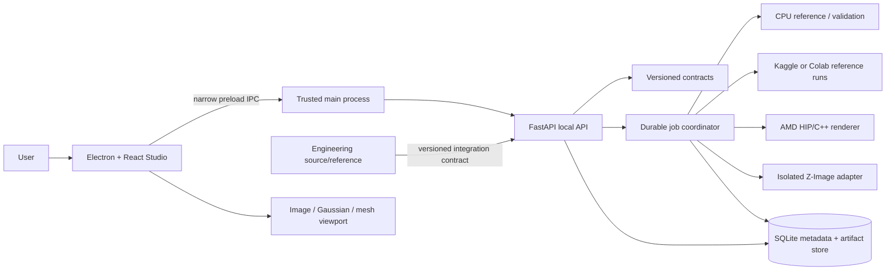
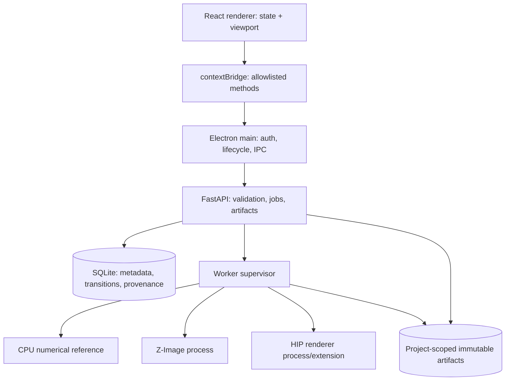
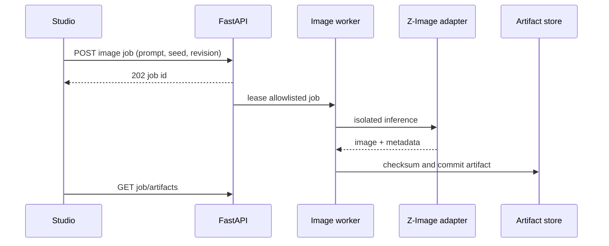
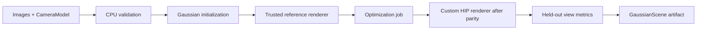

# Neural Rendering and Generative 3D Architecture

**Decision status:** proposed target architecture, revision `NR-0.2-reconciled` (2026-10-12). No neural-rendering implementation is claimed.

**Evidence labels:** `[O]` implementation observation, `[F]` external fact, `[D]` design decision, `[H]` open hypothesis. Proposed interfaces are not implemented unless explicitly marked `[O]`.

## Executive design

Berkelium Studio should be a secure desktop client over a local, versioned service boundary. The service owns model processes, HIP/C++ execution, persistence, artifact provenance, and job lifecycle. The renderer owns presentation and user intent only. A separate engineering-core integration supplies validated design intent and geometry constraints through an explicit contract; it is not copied into the Studio runtime.

The first usable research loop is:

```text
prompt or capture set
  -> typed intent/camera validation
  -> selected strategy
  -> image or multiview prior
  -> Gaussian scene initialization
  -> reference/custom differentiable optimization
  -> validation report
  -> Gaussian artifact and optional mesh artifact
  -> Studio viewport
```

An image, Gaussian scene, triangle mesh, and CAD model remain distinct artifact types. The system must display the type and confidence of every result.

## System context



## Repository-aware boundaries

The target workspace is a pnpm JavaScript/Electron/FastAPI prototype. Existing evidence includes `apps/desktop/src/App.jsx`, `ChatPanel.jsx`, `apps/desktop/electron/main.cjs`, `packages/*`, and `services/backend/main.py`. The current renderer calls FastAPI directly and the Electron window is not yet secure despite README claims; this is an integration gap, not a reason to bypass the boundary.

The engineering reference is inspected at revision `737dc35c42aaf97f52a6ac984a806adef9518525` on `origin/physics/p1-numerical`; its remote `main` is `70cc43ee41b8dec2de515be35d27e98b952337b`. It contains implemented schemas, geometry, validation, physics, API, artifact, and model-gateway code on that branch. Its README still records the project license as undecided. Reuse therefore proceeds through a versioned API/contract boundary until ownership and file-level licensing are cleared.

## Runtime topology



No worker, preload, SQLite database, or neural-rendering route exists in the inspected target source. These are implementation targets.

## Core representations

### Canonical GaussianScene

Versioned JSON metadata points to binary arrays rather than embedding million-element arrays in JSON:

```text
GaussianScene v1
  coordinateSystem: right-handed, +Y up; camera uses OpenCV +Z forward
  means:      float32[N,3]
  logScales:  float32[N,3]
  rotations:  float32[N,4] normalized quaternions
  opacityLogits: float32[N,1]
  appearance: float16/float32[N,3 or SH channels]
  source: artifact references + camera convention + provenance
  validation: metrics, finite checks, warnings
```

Training may use fp32 parameters and optimizer state; inference may use fp16/bf16 after numerical acceptance. Storage uses a documented binary format with endian, dtype, stride, and checksum. A Gaussian `.ply` is never advertised as a triangle mesh.

### Artifact lineage

Every artifact has an opaque ID, kind, media type, SHA-256, parent IDs, model/renderer revision, dataset references, configuration, and validation evidence. Mesh extraction is a derived operation with explicit quality limitations; parametric CAD requires a separate successful conversion contract.

## Workflows

### Text-to-image



Z-Image is a concept/reference generator or optional visual prior. It is not treated as a 3D generator, CAD solver, or differentiable endpoint.

### Image-to-scene reconstruction



Mip-NeRF 360 is used as a captured-scene reconstruction/evaluation source, not as text-supervised data and not as a source of ground-truth meshes.

### Text-to-3D

The first product-facing hypothesis is **Z-Image-Turbo → reviewed reference image → TripoSR explicit 3D prior → optional Gaussian fitting**. This avoids making independently prompted views look calibrated and avoids making the non-commercial Zero123++/InstantMesh chain a default dependency. MVDream/CoSER-style consistent multiview generation remains a later comparator. If views or inferred geometry disagree, request more evidence, ask for constraints, or stop with a quality warning; never silently invent geometry.

## Security and ownership

The renderer must not receive filesystem, shell, GPU, provider-key, or arbitrary URL access. The proposed BrowserWindow uses `contextIsolation: true`, `nodeIntegration: false`, `sandbox: true`, and a narrow preload. FastAPI binds loopback, authenticates local sessions, validates project scope, and applies resource quotas. Workers execute only allowlisted operations and never interpret request fields as shell commands.

Engineering-core code is not copied until a file-level license and ownership review permits it. The integration default is a versioned HTTP/JSON or shared-schema contract. The custom Berkelium HIP implementation is original code; AMD GSplat is a reference/optional backend subject to its exact license and notices.

## Main design decisions

| Decision | Selection | Revisit when |
|---|---|---|
| Renderer | CPU reference, then Berkelium HIP/C++ forward/backward path; AMD GSplat is a parity/reference aid. | Custom parity fails after bounded debugging or upstream license makes a permissible adapter preferable. |
| Representation | GaussianScene v1 with binary arrays and JSON metadata. | Mesh/CAD requirements prove Gaussian storage insufficient. |
| Text-to-3D | Z-Image-Turbo image prior + TripoSR explicit 3D prior first; multiview is a later comparator. | A licensed direct/multiview checkpoint wins the same consistency/geometry tests at an acceptable cost. |
| API | Async FastAPI jobs, SQLite metadata, project-scoped artifact store. | Measured concurrency justifies external queue/database. |
| Viewport | Extend existing React/Three.js path with a Gaussian loader; do not add a second engine without a benchmark. | Existing stack cannot meet progressive loading/memory requirements. |
| Compute | CPU/T4 for breadth; one MI300X only for verified HIP execution and late profiling. First AMD tranche is capped at 1.5 billed GPU-hours; protect 8 hours. | Provider billing, allocation, or hardware evidence changes. |

## Definition of done for the architecture

- Every result is typed, versioned, provenance-linked, and visibly labelled by artifact kind.
- CPU/reference behavior is testable without GPU access.
- HIP execution has a bounded, measurable gate and cannot consume credits implicitly.
- The Studio boundary prevents renderer privilege escalation.
- Existing engineering source and target Studio ownership are explicit and not conflated.
- The first implementation action is the CPU-only contract/gradient fixture; the first AMD action is E-A0 in `COMPUTE_BUDGET_AND_EXPERIMENTS.md`, not full training.

See `REPOSITORY_INTEGRATION_MAP.md`, `NEURAL_RENDERING_API.md`, `GAUSSIAN_RENDERER_SPEC.md`, `TEXT_TO_3D_RESEARCH_PLAN.md`, `NEURAL_DATA_PROVENANCE.md`, `NEURAL_RENDERING_DECISIONS.md`, and `NEURAL_RENDERING_ROADMAP.md` for the detailed contracts and gates.
