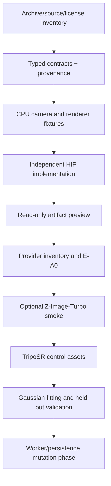

# Neural Rendering Roadmap

**Revision:** `NR-0.4` (2026-10-15)  
**Status:** milestone outcomes below are backed by receipts in `results/`; see "Milestone status" (NR-0.4).

## Order of work

## Milestones and exit gates

| ID | Work | Depends on | Exit evidence | Spend |
| --- | --- | --- | --- | --- |
| M0 | Record target archive, engineering reference, ownership and licenses. | None | `NEURAL_DATA_PROVENANCE.md`, source SHAs, unresolved items list. | CPU only. |
| M1 | Expand shared schemas for project, camera, artifact, job, error and provenance manifests. | M0 | Strict type/range/unknown-field tests; no filesystem or worker side effects on invalid input. | CPU only. |
| M2 | Implement CPU Gaussian forward/backward reference and camera adapters. | M1 | Renderer G1 fixtures, FP64 finite differences, serialization round trips, deterministic hashes. | CPU only. |
| M3 | Implement independent HIP backend and isolated worker. | M2, provider inventory | Renderer G2, 10-repeat determinism, bounded cancellation, measured memory/timing. | No allocation until M2; then E-A0 max 1.5 billed GPU-hours. |
| M4 | Install the read-only artifact preview path in the desktop boundary. | M1, security review | Preload isolation, no direct renderer HTTP/filesystem access, image/mesh/Gaussian metadata preview. | CPU/dev only. |
| M5 | Run optional image-prior smoke experiment. | M3 pass, model/license/operator preflight | E1 receipt with exact snapshot/config, finite images, measured limits, `geometry_generated=false`. | Separate approved tranche; do not assume T4/MI300X fit. |
| M6 | Run TripoSR controls and explicit mesh-to-Gaussian initialization. | M5 or owned control images, CPU extraction path | 3 control objects, valid mesh/bounds/units, 24-view orbit, rejection/failure examples. | CPU/T4 first; AMD only after approval. |
| M7 | Fit fixed-topology Gaussians and evaluate held-out views. | M2, M6 | G4 budgets, held-out metrics, provenance chain, no claim of independent geometry truth. | Bounded research run. |
| M8 | Add durable SQLite/artifact repositories and worker mutation phase. | M4, M7, auth/authorization review | Restart/cancel/reconcile tests, atomic artifact publication, explicit policy transition out of Phase 1. | Not part of current Phase 1. |

## Milestone status (NR-0.4, 2026-10-15)

| ID | Outcome | Evidence |
| --- | --- | --- |
| M0–M2 | pass | provenance docs; strict contracts + tests; CPU reference renderer with FP64 FD gradcheck (E-R0) |
| M3 | pass on one MI300X | E-R1 (10-13, rerun 10-15): 16/16 gates, bitwise-repeatable gradients, forward bitwise-equal to gsplat, backward 1.32–2.21× gsplat (`results/renderer/E-R1_analysis.md`) |
| M4 | pass (superseded by integration) | text-to-3D is a feature of the Studio scene editor (D-017); E2E `tests/e2e/test_studio_text_to_3d.py` |
| M5 | **blocked_environment** | script + pinned config ready (`scripts/m5_image_prior_smoke.py`); preflight receipt `results/m5/E-A1_preflight.json` lists the blockers on the development host (no GPU, 15 GB disk vs ~33 GB snapshot). Needs one approved MI300X session (R5 in `docs/GPU_RUN_PLAN.md`). |
| M6 | **pass on CPU** (stage C, owned controls) | TripoSR on 3 owned control images (D-020): 3/3 recognisable, valid, 24-view orbits, 47–56 s/input, ≤2.9 GiB host; Chamfer vs exact GT 0.009/0.021/0.026 (Berkelium text-to-3D 0.022/0.035/0.027); part count 1/3; meshes → Gaussians → splat render. Not done: generated anchors (needs M5); AMD/ROCm run (`results/m6/REVIEW.md`) |
| M7 | **pass on CPU** (scan renders, not photographs) | 3 Google Scanned Objects (D-021): held-out PSNR 31.7/34.7/32.9 dB (+10 to +12.5 over the silhouette init); rendered depth within 0.05 of the scan 45%/97%/99%; fine geometry not improved on thin shapes (`results/m7/SUMMARY.md`) |
| M8 | pass | SQLite jobs + transition log, write-once artifacts, resumable stages (D-019); SIGKILL-mid-fit test on a real server (`test_durable_jobs.py`); Studio "Recent" survives a backend restart (E2E) |

## Immediate implementation queue

1. `[D]` Write CPU contract fixtures using the exact camera and parameter conventions in `GAUSSIAN_RENDERER_SPEC.md`.
2. `[D]` Add strict validation and provenance-manifest tests before any model adapter.
3. `[D]` Build a read-only preview using artifact IDs and bounded metadata; do not add job submission.
4. `[D]` Request/read provider inventory only when the operator authorizes it; verify billing unit, one-GPU allocation, visible device, ROCm/PyTorch tuple, quota and balance.
5. `[D]` If M2 and the inventory pass, execute only the bounded E-A0/E0 experiment. Stop on cost ambiguity, compile failure, numerical mismatch, memory overage, or device reset.

## Explicit non-goals for this revision

- No source-code implementation, dependency installation, model download, GPU execution, fine-tuning, SDS, densification, SH appearance, multi-GPU training, CAD conversion, or production promotion.
- No claim that upstream CUDA code, benchmark numbers, model cards, or license badges prove ROCm compatibility or commercial permission.
- No attempt to make generated images into independent geometry ground truth. Unknown scale and hallucinated backs remain labelled and reviewed.

## Risk review cadence

At every milestone, record: hypothesis, exact inputs/revisions, actual output hashes, measured resource receipt, failures, remaining uncertainty, and why the next milestone is more informative than CPU-only work. A milestone can end as `pass`, `fail`, `blocked`, or `cancelled`; only the receipt may promote it to the next gate.

See `NEURAL_RENDERING_DECISIONS.md` for durable choices, `COMPUTE_BUDGET_AND_EXPERIMENTS.md` for the cost ledger, and `REPOSITORY_INTEGRATION_MAP.md` for current-versus-proposed implementation boundaries.
