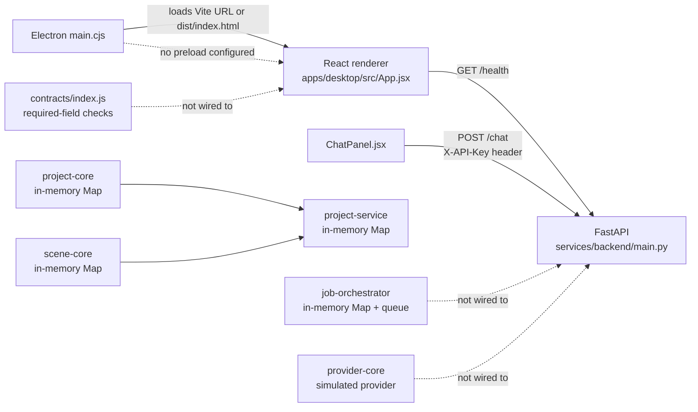
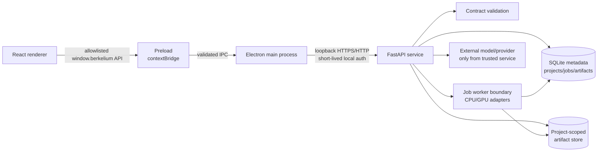

# Berkelium Studio Repository Integration Map

## Purpose and status

This document maps the extracted repository as it exists today and defines the smallest secure integration shape for the neural-rendering architecture. Every statement is labelled implicitly by its section:

- **Existing** means the referenced file currently implements or exposes it.
- **Proposed** means a target interface or design that is not implemented by the referenced files.
- **Gap** means the README or package intent is ahead of the current code.

The repository is a pnpm workspace containing `apps/desktop`, `packages/*`, and `services/*` (`pnpm-workspace.yaml`). The README describes Phase 1 as a desktop foundation and **read-only intelligence** phase and explicitly excludes file editing, CAD mutation, neural-rendering training, arbitrary command execution, and privileged renderer operations (`README.md`, lines 83–106).

## Current component map



### Existing implementation inventory

| Area | Current evidence | Current behavior | Status |
| --- | --- | --- | --- |
| Desktop shell | `apps/desktop/electron/main.cjs` | Creates a `BrowserWindow`; development loads `http://localhost:5173`, production loads `dist/index.html`. | **Existing, insecure for the target boundary**: `nodeIntegration: true` and `contextIsolation: false`; no `preload` option is supplied. |
| Renderer shell | `apps/desktop/src/App.jsx` | Provides Scene, Code, and Combined visual workspaces, panel toggles, and a five-second fetch of `http://127.0.0.1:8000/health`. The tree and viewport/editor are placeholders. | **Existing UI foundation**; health is direct renderer-to-HTTP. |
| Chat UI | `apps/desktop/src/ChatPanel.jsx` | Sends `{message}` to `POST http://127.0.0.1:8000/chat`, adds `Content-Type` and an empty `X-API-Key`, and displays `response`. | **Existing**; the renderer currently knows the backend URL and can attempt to carry a key. |
| FastAPI service | `services/backend/main.py` | Implements `GET /health`, `POST /chat`, `POST /ocr`, and `POST /pdf-ocr`, with optional `X-API-Key` enforcement, CORS, request IDs, rate limiting, size caps, and upstream Fireworks calls. | **Existing**. No project, job, artifact, or persistence routes exist. |
| Contracts | `packages/contracts/index.js` | Declares project-create, scene-load, file-read, model-query, and permission-check descriptors. `validateRequest` checks required values only; it does not enforce declared types or reject unknown fields. | **Existing foundation; not yet a typed transport contract**. |
| Projects | `packages/project-core/index.js` | `ProjectManager` stores projects in a process-local `Map`; IDs use `Date.now().toString()`; manifests are assigned in memory. | **Existing prototype; not persistent**. |
| Scenes | `packages/scene-core/index.js` | `SceneManager` stores scenes in a process-local `Map`; `createBasicScene()` returns a version `1.0` JSON scene with no objects. | **Existing prototype; not persistent**. |
| Project service | `services/project-service/index.js` | Delegates to the two in-memory managers, tracks one active project, logs structure initialization, and rejects only obvious `../` or `..\\` substrings. | **Existing service shape; the “SQLite-based” comment is not backed by SQLite code**. |
| Jobs | `packages/job-orchestrator/index.js` | Defines job types and statuses, stores jobs in memory, queues them, then immediately calls `processJob`. It simulates progress and supports status, logs, cancellation, capabilities, and placeholder checkpoint resume. | **Existing local prototype; not exposed by FastAPI and not durable**. |
| Providers | `packages/provider-core/index.js` | Registers providers and simulates connection/query responses. It does not call Ollama, LM Studio, or another provider. | **Existing adapter shape; provider I/O is proposed**. |
| Workspace/build | `apps/desktop/package.json`, `pnpm-workspace.yaml` | Vite/React/Electron scripts, Electron 44, React 19, Three.js, and workspace globs. | **Existing tooling**. |

### Important current inconsistencies

1. `README.md` describes a secure Electron/preload boundary, but `main.cjs` currently enables Node integration, disables context isolation, and defines no preload script.
2. `services/project-service/index.js` calls itself SQLite-based, but its state is held in `Map` objects and no SQLite dependency or database access is present in the supplied file.
3. The job orchestrator accepts `scientific_processing`, while its duration switch checks `science_processing`; the default duration is therefore used for the accepted scientific job type.
4. The job orchestrator processes jobs immediately in the same process and returns after completion, so its queue is not a durable asynchronous worker queue.
5. The current `contracts` descriptors document field types but `validateRequest` only checks presence. There is no shared FastAPI schema in the supplied JavaScript package.
6. The backend warns when `backend_api_key` is empty and then allows requests without a key. The renderer also hard-codes an empty key. This is suitable only for a tightly controlled local development loop, not a production boundary.

## Proposed target integration

The target keeps Phase 1 read-only while establishing interfaces that can later support long-running neural-rendering work. The target is intentionally an architecture proposal; it is not a claim that these files already exist.



### Boundary responsibilities

| Boundary | Proposed responsibility | Phase 1 posture |
| --- | --- | --- |
| Renderer | Render state and user intent only. Call a narrow `window.berkelium` API; never read files, spawn processes, hold provider keys, or construct arbitrary URLs. | Read-only UI and chat. |
| Preload | Expose named, immutable methods such as `health()`, `chat(request)`, `listProjects()`, `loadScene(projectId, sceneId)`, and `readArtifact(artifactId)`. Validate input before IPC and normalize errors. | New boundary to implement; absent today. |
| Main process | Own the BrowserWindow, preload, navigation policy, local service lifecycle, IPC handlers, project-root authorization, and secret handling. | No renderer privilege escalation. |
| FastAPI | Validate versioned JSON requests, authenticate local callers, enforce size/rate/resource limits, authorize project scope, persist metadata, and return request-correlated errors. | Existing service can be extended; only health/chat/OCR/PDF OCR are present now. |
| Persistence | Store project/job/artifact metadata transactionally in SQLite; store bytes in a project-scoped directory keyed by opaque artifact IDs and checksums. | Proposed; current managers are process-local. |
| Worker | Execute allowlisted job types outside the request handler, report state transitions and logs, and write artifacts through a controlled artifact service. | Proposed; current orchestrator only simulates in-process work. |

### Secure Electron/preload design

**Proposed BrowserWindow configuration:**

```js
webPreferences: {
  preload: path.join(__dirname, "preload.cjs"),
  contextIsolation: true,
  nodeIntegration: false,
  sandbox: true,
  webSecurity: true,
}
```

The preload should use `contextBridge.exposeInMainWorld("berkelium", api)` and expose only fixed methods. Do not expose `ipcRenderer`, `require`, filesystem handles, process objects, or a generic `send(channel, payload)` function. Main-process IPC handlers must map one channel to one operation, validate against the shared contract, and return structured errors.

The main process should:

- allow navigation only to the expected local development origin or packaged app URL;
- reject unexpected `window.open`, webviews, and external navigation unless explicitly handled through a safe external-link policy;
- keep Fireworks/provider/backend secrets in the service or main-process environment, never in renderer state or a preload object;
- pass a project ID and relative resource identifier, not an arbitrary filesystem path, across the boundary;
- canonicalize paths, reject traversal and symlink escapes, and require the resolved path to remain under the authorized project root;
- enforce a content security policy for the renderer and disable remote code execution features;
- attach a per-installation/local-session credential when calling FastAPI. An empty backend key must not be the production default.

The renderer should stop calling `fetch("http://127.0.0.1:8000/...")` directly once the bridge exists. `App.jsx` health polling and `ChatPanel.jsx` chat submission should call the bridge. During migration, the direct calls are existing behavior, not the desired final boundary.

### Proposed persistence model

Use one SQLite database owned by the trusted service (or main process through a service API), with migrations and WAL mode. Suggested tables:

- `projects(id, name, root_path, version, created_at, updated_at)`;
- `scenes(id, project_id, name, document_json, created_at, updated_at)`;
- `jobs(id, project_id, type, status, progress, priority, input_json, error_json, submitted_at, started_at, completed_at, updated_at)`;
- `job_logs(id, job_id, timestamp, level, message)`;
- `artifacts(id, project_id, job_id, kind, relative_path, sha256, byte_size, media_type, created_at)`.

The database stores metadata and authorization relationships. Artifact bytes live below an application/project-controlled root; clients address them by opaque `artifactId`, never by an arbitrary path. Writes should be transactional: create the job record before enqueueing, record every state transition, and publish an artifact row only after checksum and atomic file placement succeed. Phase 1 may expose only reads over this model and keep all mutating job endpoints disabled.

## Read-only Phase 1 migration path

| Step | Change | Existing behavior preserved | Acceptance signal |
| --- | --- | --- | --- |
| 1. Inventory and contracts | Version the request/response shapes described in `NEURAL_RENDERING_API.md`; make required/unknown-field/type validation explicit. | Existing JS managers and FastAPI endpoints can remain in place. | A malformed request is rejected before file/provider work. |
| 2. Install the Electron boundary | Add a preload and change the BrowserWindow to isolation + no Node integration. Add allowlisted IPC handlers in main. | Scene/code placeholders and the visible UI remain read-only. | Renderer has no `require`, filesystem, or generic IPC access. |
| 3. Move local calls behind the bridge | Replace direct health/chat fetches in `App.jsx` and `ChatPanel.jsx` with bridge calls; main owns the backend base URL and credential. | `/health` and `/chat` response semantics remain compatible. | Renderer no longer knows the backend credential or arbitrary backend URL. |
| 4. Add read-only FastAPI resources | Implement `GET /api/v1/projects`, scene/file metadata reads, capabilities, job status/log reads, and artifact downloads. Keep `POST /api/v1/jobs` disabled in Phase 1. | Existing `/health`, `/chat`, `/ocr`, and `/pdf-ocr` remain available during compatibility period. | A user can inspect project/scene/job/artifact state without mutation. |
| 5. Introduce persistence behind adapters | Replace `Map`-backed project/scene/job stores with SQLite/artifact-store repositories while retaining the current service method names where possible. | Existing project/scene data shape is mapped to versioned records. | Restarting the service does not erase metadata; read-only APIs are consistent. |
| 6. Add worker/write phase later | Enable authenticated job submission, cancellation, and artifact production only after authorization, quotas, worker isolation, and migration tests exist. | Phase 1 remains no-training/no-mutation. | Job writes are an explicit later capability, not an accidental renderer privilege. |

### Phase 1 read-only rule

The presence of a proposed `POST /api/v1/jobs` or cancellation endpoint in the API document does **not** mean it should be enabled now. In Phase 1, job creation, cancellation, project mutation, scene mutation, file writes, arbitrary command execution, and training are disabled or return a documented `403`/`501` policy response. Read-only inspection and the already implemented chat/OCR/PDF OCR functions are the allowed capabilities.

## Integration ownership and failure handling

- The main process is the trust anchor for the desktop client; FastAPI is the trust anchor for service-side validation and persistence.
- Every request should carry or receive an `X-Request-ID`; the current backend already generates/returns one and includes it in logs.
- IPC errors and HTTP errors should normalize to `{ code, message, requestId, details? }`; do not expose stack traces, provider credentials, absolute paths, or upstream response bodies to the renderer.
- The current backend's `401`, `413`, `415`, `429`, and `502` behavior should be preserved in the versioned API where applicable. Detailed endpoint contracts are in `NEURAL_RENDERING_API.md`.
- A backend restart must not be treated as proof that a job completed. Clients should re-read persisted job state and display `unknown`/`failed` according to the service receipt.

## Source basis and assumptions

This map is based only on `README.md`, `apps/desktop/src/App.jsx`, `apps/desktop/src/ChatPanel.jsx`, `apps/desktop/electron/main.cjs`, `packages/contracts/index.js`, `packages/project-core/index.js`, `packages/scene-core/index.js`, `packages/job-orchestrator/index.js`, `packages/provider-core/index.js`, `services/backend/main.py`, `services/project-service/index.js`, `apps/desktop/package.json`, and `pnpm-workspace.yaml`. Files or services not listed there were not assumed to exist. The proposed persistence, preload, worker, and versioned endpoints are design targets, not current implementation claims.
