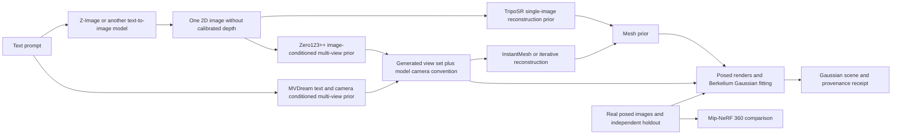

# Berkelium Text-to-3D Research Plan

**Status:** proposed research program, revision `berkelium-text3d-v0.2` (2026-10-12). This is a source-backed design and experiment plan, not an executed pipeline. No models were loaded, weights downloaded, inference run, MI300X inspected, training performed, or benchmark results produced for this documentation task.

Evidence labels used below: `[O]` inspected implementation observation, `[F]` external source fact, `[D]` Berkelium design decision, `[H]` hypothesis requiring an experiment.

## 1. Decision and existing target state

**Selected staged path:** prove Berkelium's CPU/HIP Gaussian forward/backward on owned synthetic data first; then test **Z-Image-Turbo → reviewed object image → TripoSR mesh prior → posed views → fixed-topology Berkelium Gaussian fitting**. Keep **Z-Image → Zero123++ v1.2 → InstantMesh** as a separately licensed, non-commercial research comparison only. Test MVDream as a camera-conditioned multi-view alternative after the first image/reconstruction path is understood. Use Mip-NeRF 360 as a real-capture/unbounded-scene baseline, not as a text-to-3D generator.

This selection reduces first-path license and ROCm-porting dependencies. It does **not** imply TripoSR is verified on MI300X, that a single image determines the hidden geometry, or that a mesh prior's own rendered views provide independent evidence of accuracy.

### Existing target code versus proposed work

| Surface | What exists in the extracted repository | Proposed research integration |
| --- | --- | --- |
| `packages/provider-core/index.js` | Provider abstraction with simulated connection/query behavior. | A typed image-generation adapter, isolated from local chat providers. It must not mislabel text responses as images. |
| `packages/scene-core/index.js` | In-memory scene records and empty basic JSON scenes. | Versioned Gaussian/mesh artifacts referenced by scene ID; declared scale, basis, cameras, and provenance. |
| `packages/job-orchestrator/index.js` | Simulated timed jobs and GPU capability metadata. | Separate worker leases, actual HIP capability probes, bounded execution, durable receipts. |
| `packages/interchange-layer/index.js` | Placeholder file import/export and coordinate conversions. | Real camera/mesh/Gaussian adapters with validated binary data and loss reports. |
| `services/backend/main.py` | Health/chat/OCR/PDF OCR endpoints. | Future versioned job/artifact resources described in `NEURAL_RENDERING_API.md`; none exist today. |
| Desktop | React scene viewport foundation/placeholder. | Read-only artifact preview first; research must not bypass the later write-phase boundary. |
| Native renderer | No C++/HIP renderer or neural worker in the inspected file inventory. | [GAUSSIAN_RENDERER_SPEC.md](GAUSSIAN_RENDERER_SPEC.md) is a proposed contract, not current functionality. |

The README's Phase 1 excludes neural-rendering training. Experiments are standalone later research activities, not an instruction to enable desktop training now. The extraction has no target Git commit metadata; no upstream revision is assumed.

## 2. The three problems must stay distinct



1. **Text-to-image:** Z-Image produces images conditioned on text. It does not expose a calibrated 3D scene, depth map, consistent orbit cameras, topology, or multi-view consistency objective merely because its output depicts an object. Different angle prompts or the same seed across independent calls do not make a consistent multi-view model.
2. **Multi-view generation:** MVDream generates jointly camera-conditioned views from text; Zero123++ generates a fixed set of views from one image. They improve consistency priors but can hallucinate shape, occlusion, texture, and pose. Output images still require geometry/reconstruction and camera adapters.
3. **Reconstruction/rendering:** InstantMesh and TripoSR infer a 3D prior; Mip-NeRF 360 fits a radiance field to posed captures; Berkelium's future renderer optimizes Gaussian parameters against posed observations. These are different output representations and objectives. A NeRF or mesh is not already a Gaussian artifact.

Deliverables are initially **illustrative, object-centric assets**, not measured engineering geometry, dimensionally accurate CAD, or guaranteed watertight manufacturable solids. Unknown scale is labelled `normalized_object`, never meters. An image-generation quality score alone cannot pass a 3D acceptance gate.

## 3. Candidate evaluation

Source identifiers map to exact URLs/revisions in section 10. Vendor latency/VRAM figures are upstream claims on their hardware, not Berkelium measurements.

| Candidate | Role / useful evidence | License boundary | MI300X and integration caveats | Decision |
| --- | --- | --- | --- | --- |
| **Z-Image / Z-Image-Turbo** [R1] | Text-to-image family, 6B diffusion transformer. Turbo is the smaller-step first anchor generator; upstream example uses 9 scheduler steps yielding 8 transformer evaluations, CFG 0. Base is a later quality/diversity comparison. | Repository and Turbo model card identify Apache-2.0. Record the exact model snapshot and inspect bundled text encoder/VAE and notices; a repository badge alone does not cover arbitrary third-party checkpoints. | PyTorch/Diffusers path is plausible on ROCm; test BF16 and ordinary SDPA first. Upstream CUDA/H800 latency, flash-attention options, source-install recommendations, and 16 GB claims are not MI300X guarantees. No camera-conditioned multi-view contract. | Selected first text-to-image component after kernel gate. No fine-tuning or SDS first. |
| **MVDream** [R2] | Text + camera → joint 4×256² views; separate MVDream-threestudio project performs 3D optimization. Suitable consistency comparator to separately generated angle images. | Code MIT (`LICENSE-CODE`); weights OpenRAIL, derived from SD 2.1/1.5 with upstream usage/redistribution terms. Resolve the exact license text for each chosen checkpoint/base. OpenRAIL is not equivalent to MIT. | Legacy Stable Diffusion dependencies and attention paths need a pinned ROCm environment. Camera utility defaults to Blender-world conversion; conditioning matrices are not plug-and-play Berkelium world-to-camera matrices. Repository is archived. 4 views do not guarantee recoverable geometry. | Second-wave multi-view comparison; not first end-to-end dependency. |
| **Zero123++ v1.2** [R3] | One image → six fixed 320-class-resolution object views; v1.2 has 30° output FoV, alternating elevations 20°/-10°. Strong bridge from a Z-Image anchor image. | Code Apache-2.0; **weights CC-BY-NC-4.0**. Upstream README discusses output use separately, but that does not authorize operating the model in a commercial product pipeline. Record permissions before any commercial use. | Older custom Diffusers pipeline, version-sensitive scheduler, optional xFormers, gray backgrounds, and crop/normalization assumptions. Test SDPA-compatible attention and local audited custom code. v1.1 cameras differ from v1.2. | Non-commercial research comparator only unless separate permission is obtained. |
| **InstantMesh** [R4] | Feed-forward sparse-view mesh reconstruction; usual pipeline uses Zero123++ plus a white-background fine-tuned UNet. `instant-mesh-large` is the upstream default; NeRF variants also exist. | Code and InstantMesh model card identify Apache-2.0; this does **not** override Zero123++ base-model CC-BY-NC, fine-tune inheritance, pretrained encoder terms, or component licenses (e.g. NVIDIA-origin mesh/rasterization code). Inventory every checkpoint and copied component. | Upstream recommends CUDA>=12.1, PyTorch 2.1 CUDA wheels, xFormers; requirements include nvdiffrast, bitsandbytes, PyMCubes/xatlas. NVIDIA CUDA rasterization/FlexiCubes paths need real replacement/porting work, not changing `.cuda()` to HIP. Large mesh extraction and texture export add memory/time. | Useful quality baseline; full chain is license/port blocked for first production path. |
| **Mip-NeRF 360 / MultiNeRF** [R5] | Posed multi-image optimization for unbounded real scenes, with anti-aliasing and scene contraction. Valid quality baseline on real captures, not prompt generation. | MultiNeRF code Apache-2.0; dataset/image licenses independent. Confirm scene-specific permissions before use/distribution. | JAX research environment, old dependencies/pycolmap fork, and a separate AMD-supported JAX plugin/toolchain. CUDA/JAX instructions do not establish ROCm support. Long optimization, no direct Gaussian artifact, and normalized pose transforms require adapter metadata. | Defer full training until object path and renderer correctness pass; use metrics/protocol, not a required runtime dependency. |
| **TripoSR** [R6] | Single-image feed-forward reconstruction; mesh/vertex-color output avoids mandatory six-view diffusion in the first chain. | Upstream states source, models, demo MIT; verify pinned `stabilityai/TripoSR` files, pretrained encoder, segmentation model, and dependency terms separately. | PyTorch inference is a plausible port candidate, but torchmcubes CUDA extension is a blocker until CPU extraction/replacement is verified. Texture baking adds rasterization dependencies; use vertex colors and CPU extraction first. Shape is a learned prior, not evidence of the unseen back. | Selected first reconstruction candidate with strict ROCm smoke gate. |
| **OpenLRM** [R7] | Single-image triplane/NeRF prior and mesh extraction; architecture and data-preprocessing comparison. | Apache-2.0 main code, **CC-BY-NC weights**, some NVIDIA-proprietary components explicitly called out upstream. | DINOv2/xFormers and extraction dependencies require a separate compatibility audit. It is not a blanket permissive fallback for InstantMesh. | Research comparison only; no first-path dependency. |
| **COLMAP + owned capture** [R8] | Classical pose/point initialization plus Berkelium fitting; no generative identity hallucination. | COLMAP BSD-family code; image rights and optional solver/dependency terms independent. | CPU feature extraction/matching is a valid start; GPU paths often assume CUDA and need not run on MI300X. Generated sparse views may fail matching; known synthetic/model camera poses should be used instead. | Mandatory non-generative control and practical capture path. |
| **gsplat / original 3DGS** [R9] | Renderer math/output comparison and training strategy reference. Neither generates object identity from a prompt. | gsplat Apache-2.0; original Graphdeco code research/non-commercial license. Retain per-component attribution; do not mix restricted source into Berkelium's own renderer. | CUDA extensions/wheels are not verified HIP support. Agreement is meaningful only with aligned appearance, camera, filtering, truncation, and sort settings. | Reference only; Berkelium CPU/HIP implementation stays owned and independently testable. |

**Additional alternatives to screen, not silently select:** SDXL for a smaller/mature Diffusers text-to-image control (OpenRAIL-family checkpoint terms); image-conditioned multi-view systems such as Wonder3D/SyncDreamer; feed-forward Gaussian systems such as LGM; and text-guided optimization through threestudio. Each needs a fresh code/weight/base-model license inventory and native-op audit before inclusion. Names are research leads, not reviewed permission/ROCm endorsements. A second generative stack is not required to unblock synthetic renderer tests.

### Compatibility audit required per stage

Maintain a proposed compatibility receipt with:

- Linux distribution/kernel, GPU PCI/device/architecture, driver, ROCm, hipcc, Python, PyTorch (`torch.version.hip`), Diffusers/Transformers, JAX/plugin if used, and container image digest.
- Source SHAs, model snapshot SHAs, exact pipeline/config/scheduler, tokenizers, encoder/VAE snapshots, file hashes and license/notice texts.
- Native operation inventory: attention, rasterization, marching cubes, grid sampling, texture baking, sort/scan, custom CUDA, compiled extensions, quantizers.
- Evidence per operator: `not_tested`, `CPU_verified`, `HIP_verified`, or `blocked`, plus a reproduction command and measured receipt once run.
- Explicit output parity after any attention/backend/precision/extension substitution. A successful import is not a successful inference, and successful inference is not a differentiable reconstruction proof.

Use separate environments for modern Z-Image and legacy Zero123++/InstantMesh; their Diffusers/Transformers pins differ materially. Connect stages through validated images, cameras, and artifacts, not a single fragile monolithic environment.

## 4. Staged first path and stop/go gates

| Stage | Bounded work / artifact | Go gate | Stop or next action |
| --- | --- | --- | --- |
| A — mathematical control | Implement future CPU reference and fixed-topology HIP renderer; owned analytic scenes, known poses, no pretrained models. | Renderer G1/G2 and experiment E0 pass. | Fix math, sorting, memory, or device setup. Do not use generated images to hide a renderer defect. |
| B — one image on AMD | Future E1 loads the pinned Z-Image-Turbo snapshot only after download is authorized separately; produces at most 4 anchors. | Correct device, finite output, memory/time budget, prompt and silhouette review, repeatability receipt. | Stop at 2 focused compatibility fixes / 4 engineer-hours. Preserve CPU/HIP progress; use an owned input image as the reconstruction control. |
| C — first 3D prior | TripoSR on 3 owned control images first, then up to 3 accepted anchors; vertex colors, CPU marching cubes if needed, no texture baking. | Finite mesh, nonempty faces, bounds/units metadata, renderable 24-view orbit, <=120 s/input after load, peak <=16 GiB GPU and <=8 GiB host extraction scratch. At least 2/3 control objects recognizable without major duplicated-front geometry. | If a required CUDA op cannot be replaced within 1 engineer-day, stop this path and compare a specifically audited alternative; do not declare AMD support. |
| D — Gaussian artifact | Sample the mesh surface with fixed seed, attach colors/covariances, fit Berkelium Gaussians to its posed renders. | Camera adapters pass; fixed topology N<=100k; renderer budgets pass; held-out render PSNR>=28 dB and silhouette IoU>=0.90 against the prior's own renders. | These thresholds measure representation transfer only, not true geometry. If this fails, investigate initialization/optimization before another generator. |
| E — multi-view comparison | Licensed research-only Zero123++ v1.2/InstantMesh chain and MVDream, using the same evaluation assets/protocol. | License and operator gates, no major pose mismatch, useful consistency/quality improvement at declared cost. | Restrict results to the approved research scope. Do not promote a non-commercial model by exporting its outputs through another stage. |
| F — capture/scene expansion | Owned real capture → CPU COLMAP → Berkelium fitting; later compare MultiNeRF on permitted scenes. | Registered cameras, coverage, independent held-out quality and sustained resource gates. | Reduce scope if calibration/coverage is poor; defer unbounded scenes and Mip-style extensions. |
| Product gate | Bridge/service/worker/persistence and artifact lifecycle described in companion documents. | Approved later mutation phase, authenticated job submission, real durable receipts, restart/cancel tests, license-compatible components. | Phase 1 remains read-only; no automatic production promotion from research pass. |

The first text-to-3D chain is sequential: unload the diffusion stage before reconstruction, then unload reconstruction before Gaussian fitting. No simultaneous allocation of all model weights and renderer tapes. Generated mesh/glTF previews and Gaussian scenes are distinct artifacts. The initial Gaussian transfer does not train a reconstruction foundation model.

## 5. First bounded MI300X experiment: E0 (no model weights)

**Question:** can an independently implemented Berkelium HIP forward/backward match the CPU contract and improve a small posed reconstruction on one MI300X within a predictable budget?

**Status:** planned, cannot run against today's target because its native implementation is absent. The first GPU allocation should test this question before a large dependency/weight stack.

### Preconditions and fixed budget

- One authorized Linux MI300X device, real capability probe reports `gfx942`; choose one validated ROCm/toolchain tuple and record versions/container digest. ROCm 6.3.3 docs establish target architecture, not the installed tuple [R10].
- CPU analytic/finite-difference gates G1 already pass. HIP basic fixtures G2 are part of E0 preflight.
- No network access, pretrained weights, distributed jobs, model compilation, or densification.
- **Wall-clock cap 30 minutes from first GPU operation; 16 GiB renderer context cap; 2 GiB replay checkpoint cap; 8 GiB host data/scratch cap.** A watchdog stops the attempt, synchronizes/terminates the worker, and retains a failed receipt. Do not automatically retry an uncertain attempt. This is the renderer E0 cap; the provider allocation cap is the separate 1.5 billed GPU-hour tranche in `COMPUTE_BUDGET_AND_EXPERIMENTS.md`.
- Baseline microbenchmark: `N=10,000`, 256², one camera, <=500k Gaussian/tile pairs. Timing stress case: `N=100,000`, 512², <=2m pairs. Quotas are checked from actual projection/count; a cap hit is a failure receipt, not Gaussian dropping.

### Fixture and fit

1. Generate **64 anisotropic Gaussians** with PCG32 state initialization `seed=12345`, stream `54`, centers inside `[-0.5,0.5]^3`, scales in `[0.02,0.08]`, opacity in `[0.2,0.8]`, non-saturated RGB and valid rotations. Store generated arrays/hash. Use the same fixture-generator definition as the renderer tests.
2. Render FP64 CPU truth at 128² from 12 known cameras, orbit radius 2.5, elevations alternating 15°/30°, azimuths `0,30,...,330`, vertical FoV 50°, `fx=fy=H/(2*tan(25°))`, centered principal point, `near=0.01`, `far=100`, black background. Split **train indices 0,1,3,4,6,7,9,10** and **holdout 2,5,8,11** before fitting. Store linear RGB/alpha/depth and camera manifest.
3. Produce a fixed perturbed initialization: center offsets <=0.02, log-scale offsets <=0.1, opacity/color-logit offsets <=0.1. Keep all initial branches away from clipping/clamp/cap boundaries for gradient probes. This is local recovery, not a global reconstruction result.
4. Optimize at most **200 iterations**, one training camera/step cycling through the eight views. Fixed topology; no pose refinement. Use Adam (`beta1=0.9,beta2=0.999,eps=1e-8`), base learning rate `1e-3` for raw parameter planes, unit quaternion renormalization only between steps, and report saturation/gradient norms. Loss is mean linear RGB squared error + `0.1*mean(alpha squared error)`; depth is a diagnostic initially. Do not divide images/masks differently across backends.
5. Validate CPU/HIP forward and all 14-plane gradients on small smooth subsets before optimization. Render holdout every 25 steps; report train/holdout loss curves and final RGB/alpha/depth comparisons. Stop immediately on non-finite loss/gradient/output or invalid scene.
6. For timing, run 5 warmups and 20 measured forwards and forward/backwards for each size. Use HIP events and completion synchronization. Record upload/download separately, median/p95, stage times, peak allocation, `M`, maximum pairs/tile, checkpoint bytes, and deterministic hashes. CPU timing is on the small scene only; do not infer speedup from different workloads.

### E0 go criteria

- CPU/HIP forward/backward tolerances and deterministic repetition from `GAUSSIAN_RENDERER_SPEC.md` all pass; integer ordering agrees on stable fixtures.
- All outputs/gradients/losses finite, no out-of-bounds/deadlock/resource leak or stale-tape use.
- Training loss decreases by **at least 50%** from step 0; held-out RGB MSE decreases by **at least 20%**; report absolute values too. Failure means investigate optimization/initialization, not invent a quality success.
- Stress case median forward <=100 ms, forward+backward <=500 ms, peak <=4 GiB (proposed G4 budgets); entire experiment stays within hard caps above. If correctness passes and performance fails, the receipt is `correctness_pass/performance_stop`, not an overall pass.
- Receipt contains all versions, source/config/data hashes, seed, device evidence, timing definitions, memory totals, error maxima, loss curves, and explicit `weights_used=false`.

**Stop/go:** pass permits E1 and a larger owned-data fitting trial. A mathematical failure blocks both; a performance failure permits profiling only; a missing/incompatible GPU yields `blocked_environment`. Nothing in E0 demonstrates text generation, multi-view consistency, mesh quality, CAD accuracy, or commercial readiness.

## 6. First learned-model MI300X smoke experiment: E1 (future authorization)

E1 is specified so the next action is bounded; **no download or execution is part of this document**.

- Pin **`Tongyi-MAI/Z-Image-Turbo` snapshot `f332072aa78be7aecdf3ee76d5c247082da564a6`** [R1]. Pin a Diffusers revision that exposes `ZImagePipeline`, compatible Transformers/PyTorch ROCm builds, and all text-encoder/VAE files. These dependency SHAs remain unresolved and are a preflight blocker, not an invitation to install floating `main` in a reproducibility run.
- One MI300X, one pipeline, batch 1, BF16, standard PyTorch SDPA; no FlashAttention/xFormers, quantization, `torch.compile`, LoRA, or offload in the initial run. PyTorch's `cuda:0` spelling is valid on HIP, but log `torch.version.hip` and real device ID [R10].
- Load from a pre-approved local snapshot with network disabled during inference; include weight bytes/disk receipt and license inventory. If exact files are not available, return `blocked_missing_weights`. Do not invoke scripts that automatically fetch checkpoints/custom code.
- At most **4 images**, 512×512, Turbo example schedule `num_inference_steps=9`, `guidance_scale=0.0`; seeds 42 and 43 for two fixed prompts, then repeat one seed only if the image budget allows. Compare determinism on the same tuple; cross-hardware identity is not required.
- Prompts: (1) “A single matte red ceramic teapot with one handle and one spout, centered, fully visible, three-quarter view, plain white background, soft diffuse studio lighting, no text”; (2) “A single blue toy delivery van with four black wheels, centered, fully visible, three-quarter view, plain white background, soft diffuse studio lighting, no text.” Prompts deliberately test asymmetric geometry and part counts.
- **Cap: 60 minutes total including load; <=48 GiB peak GPU allocation; <=64 GiB process RAM; 10-minute timeout per image after load.** Dependency repair cap: 4 engineer-hours/two focused fixes before recording a blocked result. Budgets are conservative experimental limits, not predicted usage.
- Receipt: load time, measured latency by stage, peak allocated/reserved/driver memory, image hash, pipeline/scheduler/dtype/backend, seed, prompt, exact source/model revisions, safety/quality review result, and `geometry_generated=false`.
- Go only if the pipeline truly executes on HIP, outputs finite 512² RGB, stays in caps, and at least one image for each prompt has a single complete object with recognizable required parts. Reject anchors with duplicate fronts, cropped parts, ambiguous transparent boundaries, unreadable silhouettes, or multiple overlapping objects. Passing this gate only supplies anchors for stage C.

This experiment does not inherit the upstream H800 speed claim, does not fit a renderer, and does not use independent view prompts as reconstruction targets.

## 7. Camera and artifact contract between research stages

Each stage emits a manifest, not just PNGs or an OBJ with undocumented axes:

```text
stage, run_id, parent_artifact_ids, status, source_revisions, model_revisions,
file_hashes, license_inventory, seed, prompt_hash_and_authorized_prompt,
image_color_space, mask_method_and_model_revision, dimensions,
camera_convention, pose_direction, matrix_storage, intrinsic_units,
view_index_and_grid_mapping, crop_resize_pad_transform,
scene_units, object_normalization, source_to_berkelium_transform,
quality_metrics, resource_receipt, warnings, synthetic_or_capture
```

- Only the trusted worker resolves artifact storage. Product UI receives opaque IDs, thumbnails, bounded metrics, and logs; prompts are retained only according to project policy.
- Z-Image output has **no calibrated camera by default**. A reconstruction model's assumed input pose/object scale is declared as a prior. Do not attach a guessed camera and label it measured.
- Zero123++ v1.2: azimuths relative to input `[30,90,150,210,270,330]`, elevations `[20,-10,20,-10,20,-10]`, FoV 30° [R3]. v1.1 instead uses `[30,-20,...]`; never mix checkpoints/cameras. Verify output mosaic slicing/order against the pinned pipeline, not an assumed view permutation.
- InstantMesh's camera utility uses **Z-up source world**, OpenGL camera-to-world poses, radius 4.0 for its input camera helper, and intrinsics normalized by image size [R4]. For a Berkelium Y-up world, one explicit proper basis rotation is `B=[[1,0,0],[0,0,1],[0,-1,0]]`; apply it to geometry and camera world coordinates. Then convert OpenGL camera axes with `F=diag(1,-1,-1,1)` and invert to `T_cw`. Multiply normalized focal/principal-point values by image dimensions. Model radius is normalized, not meters.
- MVDream camera utilities start from a Y-up OpenGL pose and by default left-multiply a Blender-world basis rotation; normalized conditioning poses are not metric capture poses [R2]. Retain the conditioning matrix and its convention, then create a separate rendering-camera adapter with explicit inverse basis conversion. Verify synthetic landmarks at azimuth 0/90/180 before fitting.
- MultiNeRF uses OpenGL camera-to-world and may apply PCA rotation/scale normalization [R5]. Save and invert that transform during metric scene comparison/export.
- Mesh-to-Gaussian conversion samples surface area with a recorded seed, sets covariance with local tangent/normal axes and neighbor-distance scale, initializes opacities/colors explicitly, and reports sampling count. It is an initialization proposal, not an existing interchange function. glTF mesh topology/material export and Gaussian binary artifact export are separate operations.
- Use a provided/manual mask for first controls. Later segmentation has its own checkpoint/license and cannot be assumed correct or free merely because `rembg` is installed. Preserve original image, mask, and postprocessed image to diagnose errors.

## 8. Evaluation protocol and research questions

### Dataset design

Start with **12 owned/explicitly permitted object assets**: four simple asymmetric solids, four thin/concave multi-part objects, and four hard cases (reflective, transparent, repeated/symmetric, fine texture). Render a fixed known-camera orbit and retain geometry ground truth for controls. Exclude transparent/reflective cases from first go thresholds, but report their failure modes separately.

For prompt evaluation use 8 predeclared object descriptions × 2 seeds, with no cherry-picked retries. Use the same accepted anchor images when comparing reconstruction models. Separately compare text-only MVDream; it is not an identical-conditioning experiment. Pre-register frame splits, postprocessing, masks, camera transforms, and one global similarity alignment before evaluating geometry.

### What to measure

| Question | Measurement | Guard against misleading conclusions |
| --- | --- | --- |
| Anchor obeys prompt? | Part-count and attribute rubric, complete silhouette, blinded review pass rate; optional frozen image/text score. | CLIP-style score alone cannot detect duplicate geometry; score-model license/versions are separate. |
| Views are consistent? | Feature tracks/reprojection on known-pose controls, silhouette agreement, texture/part correspondence across views, duplicated-front count. | A diffusion prior's camera parameters are assumptions; reprojection failure may be a pose mismatch rather than bad renderer math. |
| Reconstructed geometry? | Symmetric Chamfer/normal agreement on controls, silhouette IoU, connected components, degenerate triangles, manifold/watertightness checks. | Record units and one alignment transform; no per-view alignment. Hallucinated generated objects lack true unseen geometry. |
| Renderer transfers prior? | Held-out RGB PSNR/SSIM and alpha IoU against prior renders; max CPU/HIP error and gradient gates. | The prior's own held-out renders test distillation, not independent 3D truth. |
| Real reconstruction generalizes? | Camera-held-out linear RGB PSNR/SSIM, optionally LPIPS with licensed pinned evaluator, depth error when measured. | Separate training and test frames; compare consistent resolution, color transforms, scene masks, and pose normalization. |
| Practical AMD execution? | Cold load, warm median/p95, kernel stage times, true peak allocated/reserved/driver memory, host scratch, failed attempts. | No NVIDIA-paper latency substituted for measured MI300X results; all substitution paths listed. |

Object control stage C/D go target: >=75% of easy/mid controls have coherent single-object orbits, silhouette IoU>=0.85 against ground truth after one declared alignment, no unexplained camera mirroring, and no gross extra-front/part duplication. Per-object results and failure examples are retained. Generated prompts have **no geometry accuracy score** without independent ground truth; report plausibility/consistency and uncertainty instead.

For real capture, start with one owned static, textured object, 24–48 photos, fixed exposure and complete coverage. Require >=80% registered cameras and plausible camera trajectory; use a held-out 20% view set selected before training (record whether their poses were independently calibrated or estimated using the full set). Compare initialized versus fitted Berkelium held-out loss; claim Gaussian-vs-Mip-NeRF quality parity only after a matched, fully specified experiment. A six-view hallucinated set is not the Mip-NeRF 360 benchmark.

### Questions to answer in order

1. Is the Gaussian renderer mathematically correct and deterministic on gfx942?
2. Can one modern text-to-image stage run in a pinned ROCm environment?
3. Does a license-compatible single-image prior provide useful object geometry with bounded porting effort?
4. Can Berkelium preserve that prior as an efficient Gaussian scene?
5. Do jointly generated views improve actual control geometry/consistency enough to justify their cost and license constraints?
6. Only then: would view-conditioned score distillation, SH appearance, densification, or Mip-style filtering improve the selected objective?

SDS is deferred: a Turbo image sampler is not automatically a valid teacher objective; scheduler/noise parameterization, guidance, gradient scaling, timestep distribution, teacher license, and gradient stability need an independent experiment. Do not call a frozen T2I inference loop “differentiable text-to-3D” because it precedes a differentiable renderer.

## 9. Research receipts, timeboxing, and promotion

Every proposed run ends with `pass`, `fail`, `blocked`, or `cancelled`, accompanied by actual artifacts/checksums and resource receipts when available. `planned` is used until execution. A completion timer or UI progress bar is not a valid experiment receipt.

| Risk | Bounded response |
| --- | --- |
| Native CUDA dependencies | Enumerate ops before weight acquisition; 1 engineer-day maximum for first-path replacement spike. Keep CPU extraction as a tested explicit mode. |
| Model/license ambiguity | Preserve exact license/model cards; unresolved base-model/fine-tune permissions block commercial promotion. Research-only results remain identified by scope. |
| Inconsistent generated views | Inspect camera adapters and control assets first; reject incompatible view sets, do not let geometry fitting absorb arbitrary camera errors. |
| Memory/time explosion | One stage at a time; measured quotas; stop on excess pair/checkpoint/mesh counts; no implicit multi-GPU escalation. |
| Too-good training view metrics | Require held-out cameras and separate prior-distillation versus independent-control metrics. |
| Missing native implementation | E0 remains blocked until renderer G1/G2 implementation exists; this document itself does not satisfy those gates. |

Promotion review requires: pinned code/weights/dependencies, permitted use and notices, HIP operator evidence, representative quality and failure reports, artifact/camera round trips, bounded worker cancellation/restart, and the approved product phase. Do not download all candidate models “just in case”; select one stage and pass its preflight first.

## 10. Exact source register

Read-only source review date: **2026-10-12**. Revisions were resolved from upstream Git/Hugging Face metadata where stated. A model-family version such as `v1.2` is not a content hash; unresolved hashes must be pinned before execution. Sources supply upstream claims, not Berkelium execution evidence.

### [R1] Z-Image

- Code revision **`26f23eda626ffadda020b04ff79488e1d72004cd`**: https://github.com/Tongyi-MAI/Z-Image/tree/26f23eda626ffadda020b04ff79488e1d72004cd
- README/architecture/inference settings: https://github.com/Tongyi-MAI/Z-Image/blob/26f23eda626ffadda020b04ff79488e1d72004cd/README.md
- Code license: https://github.com/Tongyi-MAI/Z-Image/blob/26f23eda626ffadda020b04ff79488e1d72004cd/LICENSE
- Turbo model snapshot **`f332072aa78be7aecdf3ee76d5c247082da564a6`** and card: https://huggingface.co/Tongyi-MAI/Z-Image-Turbo/tree/f332072aa78be7aecdf3ee76d5c247082da564a6 and https://huggingface.co/Tongyi-MAI/Z-Image-Turbo/blob/f332072aa78be7aecdf3ee76d5c247082da564a6/README.md
- Base model: https://huggingface.co/Tongyi-MAI/Z-Image (snapshot unresolved; not selected for E1).
- Report: https://arxiv.org/abs/2511.22699 (paper version unresolved). Editing/Omni availability must be rechecked if those variants are considered; neither is needed here.

### [R2] MVDream

- Code revision **`618f84476c88e04adaf588133be2830142b9956d`**: https://github.com/bytedance/MVDream/tree/618f84476c88e04adaf588133be2830142b9956d
- Scope/checkpoint families: https://github.com/bytedance/MVDream/blob/618f84476c88e04adaf588133be2830142b9956d/README.md
- MIT code terms: https://github.com/bytedance/MVDream/blob/618f84476c88e04adaf588133be2830142b9956d/LICENSE-CODE
- Camera conditioning: https://github.com/bytedance/MVDream/blob/618f84476c88e04adaf588133be2830142b9956d/mvdream/camera_utils.py
- Model card/OpenRAIL identifier: https://huggingface.co/MVDream/MVDream/blob/main/README.md (weight snapshot unresolved).
- 3D optimization integration: https://github.com/bytedance/MVDream-threestudio (revision unresolved).
- Paper: https://arxiv.org/abs/2308.16512 (paper version unresolved).

### [R3] Zero123++

- Code revision **`7d0315c31be6eb906b34cf07d91310f8e12e9b95`**: https://github.com/SUDO-AI-3D/zero123plus/tree/7d0315c31be6eb906b34cf07d91310f8e12e9b95
- Camera parameters and code/weight license distinction: https://github.com/SUDO-AI-3D/zero123plus/blob/7d0315c31be6eb906b34cf07d91310f8e12e9b95/README.md
- Apache code license: https://github.com/SUDO-AI-3D/zero123plus/blob/7d0315c31be6eb906b34cf07d91310f8e12e9b95/LICENSE
- Candidate **v1.2** checkpoint: https://huggingface.co/sudo-ai/zero123plus-v1.2 (snapshot unresolved); custom pipeline: https://huggingface.co/sudo-ai/zero123plus-pipeline (snapshot unresolved).
- Paper: https://arxiv.org/abs/2310.15110 (paper version unresolved).

### [R4] InstantMesh

- Code revision **`08822c52fdc399b93ea00e4fa9e596344ed52ccc`**: https://github.com/TencentARC/InstantMesh/tree/08822c52fdc399b93ea00e4fa9e596344ed52ccc
- Installation/inference/variant scope: https://github.com/TencentARC/InstantMesh/blob/08822c52fdc399b93ea00e4fa9e596344ed52ccc/README.md
- Dependencies: https://github.com/TencentARC/InstantMesh/blob/08822c52fdc399b93ea00e4fa9e596344ed52ccc/requirements.txt
- Camera normalization/basis: https://github.com/TencentARC/InstantMesh/blob/08822c52fdc399b93ea00e4fa9e596344ed52ccc/src/utils/camera_util.py
- Code license: https://github.com/TencentARC/InstantMesh/blob/08822c52fdc399b93ea00e4fa9e596344ed52ccc/LICENSE
- Model card: https://huggingface.co/TencentARC/InstantMesh/blob/main/README.md (snapshot unresolved, Apache-2.0 metadata does not erase upstream weight restrictions).
- Paper: https://arxiv.org/abs/2404.07191 (paper version unresolved).

### [R5] Mip-NeRF 360 / MultiNeRF

- Code revision **`5b4d4f64608ec8077222c52fdf814d40acc10bc1`**: https://github.com/google-research/multinerf/tree/5b4d4f64608ec8077222c52fdf814d40acc10bc1
- README/JAX/camera conventions: https://github.com/google-research/multinerf/blob/5b4d4f64608ec8077222c52fdf814d40acc10bc1/README.md
- Code license: https://github.com/google-research/multinerf/blob/5b4d4f64608ec8077222c52fdf814d40acc10bc1/LICENSE
- Paper/data project: https://jonbarron.info/mipnerf360/ and https://arxiv.org/abs/2111.12077 (paper version and dataset release/license details unresolved).

### [R6] TripoSR

- Code revision **`107cefdc244c39106fa830359024f6a2f1c78871`**: https://github.com/VAST-AI-Research/TripoSR/tree/107cefdc244c39106fa830359024f6a2f1c78871
- Scope, MIT model/code statement, CUDA extraction caveat: https://github.com/VAST-AI-Research/TripoSR/blob/107cefdc244c39106fa830359024f6a2f1c78871/README.md
- Code license: https://github.com/VAST-AI-Research/TripoSR/blob/107cefdc244c39106fa830359024f6a2f1c78871/LICENSE
- Weights: https://huggingface.co/stabilityai/TripoSR (snapshot unresolved; preflight gate).
- Paper: https://arxiv.org/abs/2403.02151 (paper version unresolved).

### [R7] OpenLRM

- Versioned release lead **v1.1.1**: https://github.com/3DTopia/OpenLRM/releases/tag/v1.1.1 (commit unresolved).
- Reviewed mutable README: https://github.com/3DTopia/OpenLRM/blob/main/README.md
- Separate license files: https://github.com/3DTopia/OpenLRM/blob/main/LICENSE, https://github.com/3DTopia/OpenLRM/blob/main/LICENSE_WEIGHT, https://github.com/3DTopia/OpenLRM/blob/main/LICENSE_NVIDIA
- Model card: https://github.com/3DTopia/OpenLRM/blob/main/model_card.md (revision unresolved).

### [R8] Capture/control alternatives

- COLMAP: https://github.com/colmap/colmap and https://github.com/colmap/colmap/blob/main/COPYING.txt; file/camera format: https://colmap.github.io/format.html (revisions unresolved; validate selected release before execution).
- Unselected alternatives, unpinned research leads: https://huggingface.co/stabilityai/stable-diffusion-xl-base-1.0, https://github.com/xxlong0/Wonder3D, https://github.com/liuyuan-pal/SyncDreamer, https://github.com/3DTopia/LGM, https://github.com/threestudio-project/threestudio. Their full code/weight compatibility and permission inventory was **not** completed in this task.

### [R9] Gaussian comparison implementations

- Algorithm/paper: https://repo-sam.inria.fr/fungraph/3d-gaussian-splatting/ and https://arxiv.org/abs/2308.04079 (paper version unresolved).
- Original implementation and restrictive license: https://github.com/graphdeco-inria/gaussian-splatting/blob/main/LICENSE.md (`main` reviewed, exact commit unresolved).
- AMD GSplat release **`1.5.3b2`**, source revision **`ff8bc5489545bcc1b5a2b997d975834429a0d7af`**: https://github.com/AMD-Ecosystem/gsplat/tree/ff8bc5489545bcc1b5a2b997d975834429a0d7af and https://rocm.docs.amd.com/projects/gsplat/en/latest/reference/benchmark-evaluation.html. NOTICE describes Apache-2.0 upstream portions and MIT AMD modifications; treat it as a comparison/reference implementation, not Berkelium-owned renderer code. The older nerfstudio gsplat revision is not the selected AMD reference.

### [R10] AMD/framework references

- MI300X architecture, versioned ROCm **6.3.3 docs**: https://rocm.docs.amd.com/en/docs-6.3.3/reference/gpu-arch-specs.html
- Runtime compatibility matrix: https://rocm.docs.amd.com/en/latest/compatibility/compatibility-matrix.html (mutable; select and archive the actual environment's supported tuple).
- PyTorch HIP device/API semantics: https://docs.pytorch.org/docs/stable/notes/hip.html (mutable).
- AMD JAX installation lead: https://rocm.docs.amd.com/projects/install-on-linux/en/latest/install/3rd-party/jax-install.html (mutable; not evidence MultiNeRF's old dependencies work on the chosen MI300X tuple).

## 11. Assumptions and unresolved decisions

- A later authorized Linux MI300X worker is available; hardware, ROCm stack, and native builds remain unverified.
- Berkelium aims for a potentially commercial product, so a non-commercial model pipeline cannot be the default production path.
- First assets are bounded isolated objects in normalized units; real scale/calibration and unbounded-scene support come later.
- Owned synthetic/control data and independent camera/geometry ground truth can be supplied; no third-party dataset rights are presumed.
- Source metadata/code/model cards were read for design; no weights, external repos, or native toolchains were installed or executed.
- Exact Diffusers/PyTorch/TripoSR model revisions and every dependency's compatibility must be resolved before E1/stage C. Proposed quality/resource gates are engineering decisions, not observed results.
- The companion renderer, integration map, and API documents describe target interfaces. The current repository files do not implement this research pipeline.
